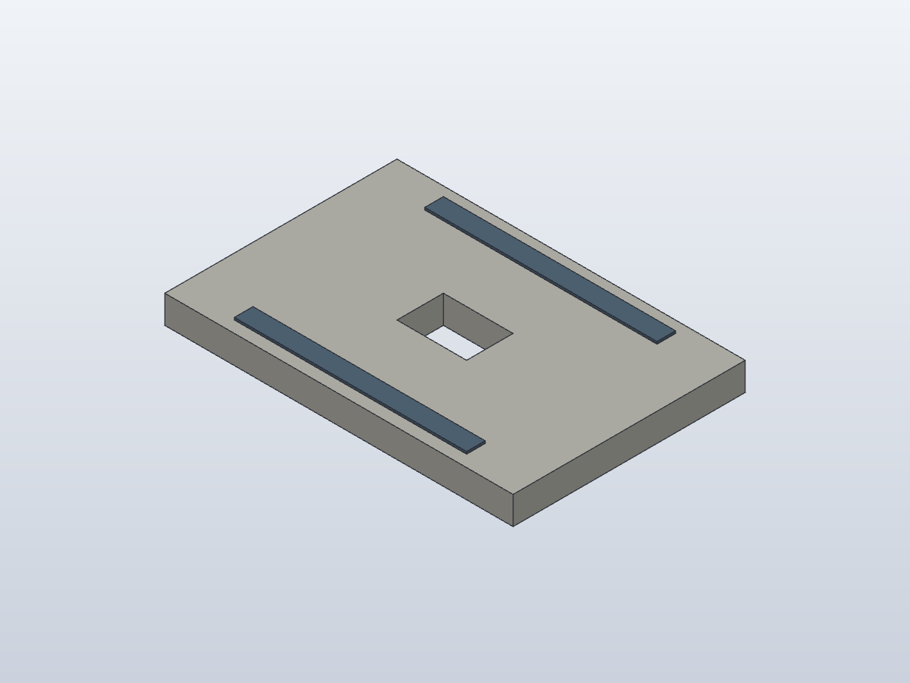
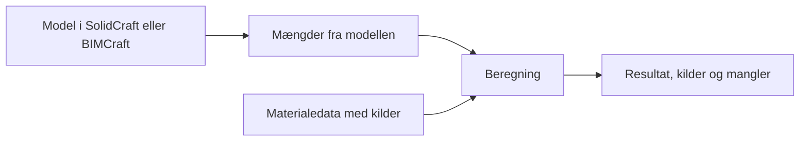

<div align="center">

# Åbne materialedata til arkitekter

**Fra en model og dokumenterede materialetal til vægt, klimabidrag og forklarlige resultater.**

Et åbent projekt fra **Fremtidens Tegnestue** til arkitekter, ingeniører, studerende og udviklere.

[Kom godt i gang med Rust-CLI’et](docs/RUST.md) · [Se et gennemført eksempel](examples/integrated-workflow/README.md) · [Alle data](data/README.md) · [Ordliste](docs/ORDLISTE.md)

</div>



## Hvad kan du bruge det til?

Forestil dig, at du har tegnet en bygningsdel og vil vide, hvad den vejer, hvordan dens produktionsklima ændrer sig med tykkelsen, eller hvor meget et træemne kan bevæge sig ved ændret fugt. Modellen beskriver formen. Materialedataene beskriver egenskaberne. Vores værktøj forbinder dem og viser, hvor tallene kommer fra.

Du kan allerede:

- **Søge i materialedata** og finde værdier med enheder, betingelser og kildehenvisninger.
- **Beregne vægt** fra en dokumenteret mængde og en valgt densitet.
- **Beregne klimabidrag** for en valgt indikator og et bestemt livscyklusmodul.
- **Undersøge træets fugtbevægelse** med dokumenterede arts- og retningskoefficienter inden for deres gyldighedsområde.
- **Læse modeller fra SolidCraft og BIMCraft**, afprøve ændringer og få en oversigt over manglende oplysninger.
- **Lade en AI-agent hjælpe med arbejdet**, mens materialevalg, kilder og antagelser forbliver synlige.

Du behøver ikke kende AI eller kunne programmere for at læse eksemplerne. På din egen computer kan du bruge Rust-programmet til at gentage beregningerne. [Følg guiden til installation og første opslag](docs/RUST.md).

## Start dér, hvor du er

| Du vil … | Start her |
| --- | --- |
| Forstå idéen uden at installere noget | [Testmodellen og dens resultater](examples/integrated-workflow/README.md) |
| Have en AI-agent til at hjælpe | [Materialevalget i SolidCraft og BIMCraft](examples/unified-workflow/README.md) |
| Søge og beregne selv | [Installation og dine første kommandoer](docs/RUST.md) |
| Bruge datasættet i egne analyser | [Dataformater, indhold og versioner](data/README.md) |
| Forstå ord som EPD, BIM, CLI og MCP | [Ordliste](docs/ORDLISTE.md) |
| Se afprøvningen på et rigtigt byggeri | [Lisbjerg Bakke](reports/lisbjerg-bakke/README.md) |

## Tre værktøjer, der arbejder sammen

### SolidCraft: formen og detaljen

**SolidCraft** er et selvstændigt, åbent CAD-program. Her tegner du konkrete emner: en plade, et beslag eller en konstruktionsdetalje. Du kan angive mål som parametre og ændre dem senere. Programmet måler geometrien og kan styres af både mennesker og agenter.

[Hent SolidCraft](https://solidcraft.io/download/) · [Officiel vejledning](https://docs.solidcraft.io/) · [Kildekode](https://github.com/tangency-labs/solidcraft)

### BIMCraft: bygningen og dens oplysninger

**BIMCraft** fra IPedrax er et selvstændigt, åbent BIM-program. Det arbejder med bygningsdele som vægge, dæk, vinduer, rum og etager samt tegninger og IFC-modeller. Det kan også importere generisk geometri fra SolidCraft. Programmet har ligesom SolidCraft en kommandolinje til agenter og automatisering.

[Hent den afprøvede BIMCraft 0.12.0](https://github.com/IPedrax/BIMCraft/releases/tag/v0.12.0) · [Officiel vejledning og kildekode](https://github.com/IPedrax/BIMCraft)

### Materialeværktøjet: egenskaber, kilder og beregninger

**Dette repository** leverer materialedataene og beregningsværktøjet. Det læser mængder fra programmerne, forbinder dem med udtrykkeligt valgte kildeværdier og gemmer beregningerne med deres dokumentation. Det nuværende CLI, `ft-materials`, er skrevet i Rust. Det læser materialedata og taler direkte med de to modelprogrammers CLI’er.



En **AI-agent** kan koordinere trinene. Den skal have adgang til projektmappen og kunne køre lokale værktøjer. En almindelig browserchat har ikke automatisk den adgang. En **skill** er den medfølgende arbejdsvejledning til agenten; den installerer ikke programmerne eller et AI-abonnement.

> Du behøver ikke begge modelprogrammer til alle opgaver. Materialeopslag og beregning af kendte mængder kan bruges alene. SolidCraft og BIMCraft installeres, når du vil arbejde med deres modeller.

## Tallene følger med

**Projektets fire grunddatasæt følger med i Parquet. Det åbne Tampere-tillæg følger med som strukturerede poster og originalfiler. Danske produktdeklarationer kan tilføjes fra udgiverens egne PDF’er.** Rust-programmet forbinder kilderne gennem ét skema med materialer, egenskaber, betingelser og versioner.

| Udgave | Kilder | Materialeposter | Observationer |
| --- | ---: | ---: | ---: |
| Grundlag fra ÖKOBAUDAT, OpenStudio/EnergyPlus, USDA og BR18 | 7.135 | 11.161 | 1.985.582 |
| Offentlig udgave med Tampere | 7.137 | 11.204 | 1.986.184 |
| Lokal udgave med Tampere og EPD Danmark | 8.057 | 11.286 | 2.001.578 |

En observation kan være et tal, en hel kurve eller et felt, kilden udtrykkeligt markerer som manglende. Tampere bidrager med 387 kurver for 43 materialeprøver. De danske produktdeklarationer bidrager med 15.313 tal for 32 indikatorer samt 81 kildemarkeringer. Kildespecifikke poster kan omhandle det samme materiale. [Tampere](data/supplements/tampere/README.md) · [EPD Danmark](data/supplements/epd-danmark/README.md)

Programmet bygger den store SQLite-base én gang fra omkring 91 MB Parquet. Efterfølgende udgaver genbruger den samme base og gemmer tillæg i separate SQLite-filer. Hver udgave har et fast ID, så et gammelt projekt kan genberegnes efter en dataopdatering. [Datamodel, løbende kildetjek og installation](docs/RUST.md)

## Et faktisk gennemført forløb

Vi har bygget modellen på billedet i SolidCraft, importeret den i BIMCraft og beregnet materialerne fra begge programmer. Den består af en betonplade med et hul og to stålskinner. Derefter ændrede vi pladetykkelsen fra 100 til 120 mm og gentog forløbet.

| Valgte referencematerialer | Plade på 100 mm | Plade på 120 mm |
| --- | ---: | ---: |
| Beregnet masse | 335,984 kg | 400,6688 kg |
| Produktionsklima, A1–A3 | 55,28984 kg CO₂e | 62,23064 kg CO₂e |

Resultaterne stemmer med en uafhængig beregning fra mål og original Excel. Overførte trekanter er kontrolleret, og geometrien er også sendt tilbage til SolidCraft. Gamle materialebindinger bliver afvist efter modelændringen. [Se modeller, kilder og alle kontroller](examples/integrated-workflow/README.md).

Dette er et dokumenteret referencescenarie. GLB-overførslen giver generiske BIM-komponenter, og materialereferencer kobles eksplicit. CAD-historik og en automatisk synkronisering følger ikke med gennem GLB.

## Din første beregning

Du kan hente projektet med den grønne **Code → Download ZIP**-knap og pakke det ud. Har du Git installeret, kan du i stedet bruge:

```sh
git clone https://github.com/FremtidensTegnestue/open-source.git
cd open-source
```

Med Rust og Cargo installeret kan du bygge CLI'et og bruge det fra projektmappen. På Linux kan du også hente en færdig binærfil til din processor fra [projektets udgivelser](https://github.com/FremtidensTegnestue/open-source/releases).

```sh
cargo install --locked --path .
ft-materials build
ft-materials search beton --limit 5
ft-materials lookup tampere:material:D1 --property property:thermal_conductivity
ft-materials calculate examples/requests/environmental-1000kg.json
```

Sidste kommando giver **429,5 kg CO₂e i modul A1** for 500 kg af den valgte reference. På en model kan agenten bruge ét fastholdt materialevalg i både SolidCraft og BIMCraft. [Se de faktiske modeller og kommandoer](examples/unified-workflow/README.md).

## Prøv med en agent

Åbn projektmappen i et agentprogram med adgang til lokale filer og terminal. Du kan begynde med denne besked:

> Læs README.md, docs/RUST.md og .agents/skills/material-model-assessment/SKILL.md. Hjælp mig med det medfølgende eksempel. Vis, hvor mængder og materialetal kommer fra, og forklar resultatet på almindeligt dansk. Skeln mellem dokumenterede oplysninger, referencescenarier og manglende data.

Derefter kan du eksempelvis bede om:

> Undersøg min model og vis, hvilke dele vi kan beregne vægt og produktionsklima for. Brug konkrete kilder. Gem resultatet og forklar, hvad der mangler for de øvrige dele.

Der følger ingen AI-tjeneste, API-nøgle eller abonnement med. Brug af en valgt AI-tjeneste kan have sine egne omkostninger og vilkår. Materiale-CLI'et kan også bruges direkte uden AI.

## Hvad er efterprøvet — og hvor går grænsen?

Den samlede modelkæde er afprøvet med **SolidCraft CLI 0.44.0** og **BIMCraft CLI 0.12.0**. De afprøvede modeller, programversioner og kontrolresultater ligger sammen med eksemplerne. Andre versioner og operativsystemer er ikke automatisk dækket af samme kontrol.

Kernen omfatter masse, modulvis GWP-skalering og en afgrænset træfugtmetode. Databasen indeholder flere egenskaber, end beregningsværktøjet endnu har metoder til. En hel bygnings LCA, bæreevne, brand, lyd og fugtsikkerhed kræver yderligere grundlag og relevante faglige beregninger. Et materialematch på navn er et forslag, og uafklarede værdier bliver ikke til nul.

[Læs metoderne](docs/CALCULATIONS.md) · [Datadækning](docs/COVERAGE.md) · [Kontrolforløb](docs/VALIDATION.md)

## Find rundt i projektet

| Mappe | Indhold |
| --- | --- |
| [`data/`](data/README.md) | Hele datasættet i Parquet, skema, kontrolsummer og distributionsmanifest |
| [`docs/`](docs/KOM-GODT-I-GANG.md) | Begynderguide, ordliste, datakilder og tekniske metoder |
| [`examples/`](examples/README.md) | Modeller, kørselsfiler og gennemførte beregninger |
| [`scripts/`](scripts/README.md) | Byg eller hent databasen, og hent originalkilder |
| [`adapters/`](adapters/) | Læsning af SolidCraft-/BIMCraft-modeller |
| [`collectors/`](collectors/) | Indsamling og strukturering af kildegrundlaget |
| [`reports/`](reports/README.md) | Lisbjerg Bakke og de dokumenterede erfaringer |
| [`openwiki/`](openwiki/quickstart.md) | Fordybelse i projektets værktøjer, kilder og idéer |
| [`src/`](src/) | Rust-CLI, modeladaptere, dataindsamling og beregninger |
| [`tests/`](tests/) | Automatiske kontroller |

## Baggrund og bidrag

Vandkunstens [åbne værktøjer og Lisbjerg-materiale](https://opensource.vandkunsten.com/) gav os et konkret udgangspunkt. Dette projekt udvider idéen med brede materialedata, en fælles beregningsindgang og arbejdsgange for agenter. SolidCraft og BIMCraft er selvstændige projekter med egne udviklere og licenser.

Du kan bidrage med kildebaserede rettelser, bedre materialekoblinger, nye beregningsmetoder eller tydeligere eksempler. [Læs bidragsguiden](CONTRIBUTING.md), eller [opret et issue](https://github.com/FremtidensTegnestue/open-source/issues).

Egenudviklet kode er udgivet under [MIT](LICENSE). Kildedata, eksterne programmer og dokumentation beholder deres egne vilkår; se [kilder og rettigheder](THIRD_PARTY.md).
