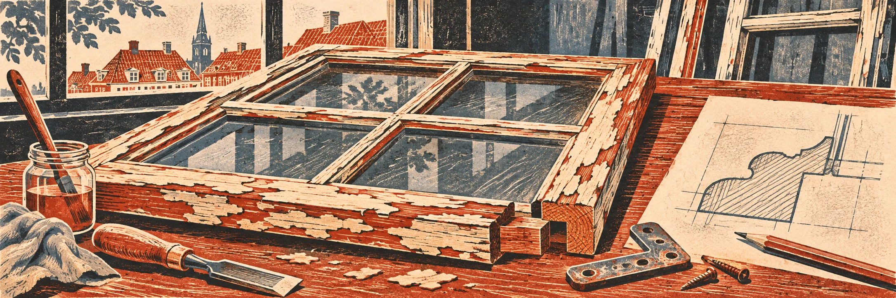

# Fremtidens Tegnestue

**Forstå, hvad dine designvalg betyder.**

Åben viden og værktøjer til at undersøge, hvordan det, vi bevarer, forandrer og bygger, påvirker mennesker, ressourcer og klima. Tag udgangspunkt i din egen byggesag, undersøg mulighederne, og find grundlaget for at vælge.

**[Åbn viden og værktøjer i browseren](https://fremtidenstegnestue.github.io/open-source/)** — du kan begynde uden installation eller konto.

Til arkitekter, konstruktører, ingeniører, bygherrer, håndværkere og andre, der vil undersøge et byggeri. Begynd med det, du vil skabe eller forandre, de valg du står med, og de konsekvenser du har brug for at forstå. Det kan handle om brug og arkitektoniske kvaliteter, bevaring, materialer, klima, økonomi eller levetid.

Brug materialet selv, eller tag din egen AI med til at udfordre mulighederne, finde kilder og opdage manglende grundlag. [Se, hvordan du kan tage udgangspunkt i din egen opgave](https://fremtidenstegnestue.github.io/open-source/#brug-ai).

[Ny på GitHub? Den korte vejledning](START-HER.md).

**Hvad vil du skabe, bevare eller forandre?**

Vi er arkitekt Thais Espersen og systemudvikler Mikkel Freltoft Krogsholm. Sammen bygger vi de værktøjer, vi selv gerne vil have ved tegnebordet. Her deler vi vores materialedata, beregninger og en håndbog om transformation og genbrug. Du kan åbne en byggesag, se hvad beboerne oplevede, eller tage tallene med ind i din egen model.

## Find grundlag for dit valg

- **Find faglig viden om din opgave:** [Læs om bygninger, genbrug og samlinger](https://fremtidenstegnestue.github.io/open-source/#boeger). Vælg den viden, der kan belyse dit designvalg. [Vinduestegningen](https://fremtidenstegnestue.github.io/open-source/vinduet.html) er et valgfrit eksempel, når en bygningsdels betegnelser er relevante.

- **Finde et materialetal uden installation:** [Søg i materialeopslaget i browseren](https://fremtidenstegnestue.github.io/open-source/#materialer). Find en reference, se klimatal, enheder og kilder, og hent de præcise data. Første browserudgave viser 507 danske referencer fra 2025.

- **Bruge flere datakilder eller regne på egne mængder:** [Følg den korte startvejledning](materialer/docs/KOM-GODT-I-GANG.md). Opslag i det større datagrundlag og beregningsværktøjerne har deres egne installationsveje. Du kan først følge et færdigt regnestykke i browseren.

- **Hente bøger til skærm eller papir:** [Find de otte bøger og deres PDF-filer](bogserie/README.md). Du skal bruge en PDF-læser. Modeller og byggeprogrammer er valgfrie.

- **Bidrage med viden, fejlrettelser eller kode:** [Brug projektet og byg videre](CONTRIBUTING.md). Start med din erfaring eller fejlbeskrivelse. Udviklerguiden viser de relevante tests.

Vælg det materiale eller den viden, der er relevant for din egen opgave. Vil du først se metoden, kan du frivilligt [undersøge en egetræsreference](https://fremtidenstegnestue.github.io/open-source/#q=egetr%C3%A6) eller [følge betonpladeeksemplet](https://fremtidenstegnestue.github.io/open-source/regneeksempel.html). Eksemplerne viser deres eget afgrænsede grundlag; de er ikke nødvendige trin før dit eget projekt.

Du kan læse og downloade indholdet uden GitHub-konto. En konto er nødvendig for at oprette issues, lave en fork eller sende ændringer tilbage. [Se, hvad der er afprøvet](#hvad-er-afprøvet) · [Mød tegnestuen](https://fremtidenstegnestue.dk/om).

<!-- Forsideillustration skabt med den indbyggede ImageGen. Prompt: Ultrabred, tekstfri forsideillustration til Fremtidens Tegnestue. Vis et gammelt dansk trævindue under reparation på et arbejdsbord, med false, afskallet linoliemaling, løst hjørnebeslag og en blyantstegnet profildetalje. Arkitektfagligt linoleumstryk på varmt papir i teglrød, kulsort og gråblå. Komponér hele motivet vandret i format 3:1. -->

## Når facaden skal blive, og boligerne skal være varmere

På Ryesgade 30 A–C i København fortæller beboere, at de efter renoveringen igen kunne bruge de dele af boligen, hvor det før trak. Ude på gaden står den murede facade stadig. I håndbogen kan du følge vinduesforsøgene i prøvelejligheden, se hvad der gik galt med isoleringen og finde målingerne efter indflytning. Undervejs kan du slå op i projektets egne tegninger og rapporter. [Læs om Ryesgade](transformation-og-genbrug/praksis/etagehus.md) · [Se projektgruppens egen beskrivelse](https://renover.dk/projekt/ryesgade-30-a-c/)

Andre sager følger en villa i Gentofte, der blev til to boliger, og en almen blok i Tilst, hvor beboerne skulle beslutte, om de ville vende tilbage efter renoveringen. Skal du selv ud at se på en bygning, kan du tage vores arbejdsark med. [Følg de tre danske byggesager](transformation-og-genbrug/praksis/README.md) · [Tag arbejdsarket med på besigtigelse](transformation-og-genbrug/oplaeg/forste-besigtigelse.md)

## Fra en tegning til et tal, du kan forklare

I Vandkunstens konstruktionsmodel for **Lisbjerg Bakke** fandt vi 75 trædæk med et samlet volumen på knap **355 m³**. Modellen giver os mængden. For at regne på klimaaftrykket skal vi også vide, hvilket træprodukt der blev brugt. Rapporten giver dig mængderne og de spørgsmål, vi ville stille projektholdet, før vi satte tal på klimaaftrykket. [Læs vores rapport](materialer/reports/lisbjerg-bakke/README.md) · [Hent originalmodellen hos Vandkunsten](https://opensource.vandkunsten.com/07_FBABLisbjerg/)

I materialebanken kan du også undersøge, hvor meget træ bevæger sig, når fugten ændrer sig, og hvad en bestemt glasdør kræver af vedligehold. Den offentlige dataudgave fra november 2026 rummer **over to millioner observationer**. Tallene følger med, så du selv kan undersøge enheder, betingelser og kilder. [Hent dataene](materialer/data/README.md) · [Se eksemplet med glasdøren](materialer/docs/sources/operations.md)

### Prøv det på en hylde

En krydsfinerplade og to stålskinner er nok til at afprøve hele forløbet. I **SolidCraft** tegner vi delene. I **BIMCraft** finder vi dem igen i bygningsmodellen. Vores materialeværktøj i Rust beregner hyldens vægt til **2,277 kg** og klimaaftrykket fra produktionen til **1,238 kg CO₂e**. I **FieldCraft** undersøger vi, hvor meget en skinne bøjer, når hylden belastes. Du kan følge regnestykket direkte i browseren eller hente modellen og ændre lasten selv. [Se hylden og beregningerne](materialer/examples/hyldekonsol/README.md) · [Hent programmerne og se, hvordan de spiller sammen](materialer/docs/PROGRAMMER.md)

Bruger du en AI-agent, kan du åbne projektmappen og give den en opgave på almindeligt dansk. [Kom i gang med materialeværktøjet](materialer/docs/KOM-GODT-I-GANG.md)

> Gennemgå hyldeeksemplet med mig. Hvad sker der med stålskinnens nedbøjning, hvis jeg sænker lasten fra 100 til 80 newton? Vis kilden til stålets stivhed, og fortæl mig, hvad vi stadig skal vide om væggen og skruerne.

## Hvilken byggesag sidder du med?

Har du et vindue, du gerne vil redde, en model med mangelfulde materialetal eller erfaringer fra en ombygning, som andre kunne lære af? Vi vil gerne høre, hvilken beslutning I står over for på jeres tegnestue, og se på, hvordan vi kan hjælpe.

**[Tal med Thais og Mikkel om din sag](https://fremtidenstegnestue.dk/kontakt-os)** · [Bidrag med viden, rettelser eller kode](CONTRIBUTING.md)

## Hvad er afprøvet?

- **Håndbog, fagordbog og bøger:** Brug dem til at læse faglige forklaringer, finde originalkilder og forberede spørgsmål til et projekt. Kilder og afgrænsninger følger de enkelte opslag. Indholdet er ikke et samlet udførelses- eller dimensioneringsgrundlag.

- **Materialeopslag i browseren:** Søg i de 507 referencer i BR18's generiske tabel 7 fra 2025 uden installation eller konto. Se kildens referencemængde, enheder, betingelser og klimafaser, og hent de præcise data. Tallene gælder kildens reference og vises fase for fase; de er et grundlag for videre undersøgelse af dit projekt. [Brug opslaget](https://fremtidenstegnestue.github.io/open-source/#materialer).

- **Lokale materialeopslag:** Undersøg det større datagrundlag med værdier, enheder og betingelser fra flere kilder. Det første lokale opslag er testet på Windows, macOS og Linux og fra en offentlig ZIP i et nyt miljø. [Kontrolforløbet](materialer/docs/VALIDATION.md) beskriver omfanget; [startvejledningen](materialer/docs/KOM-GODT-I-GANG.md) viser opsætningen.

- **Materialeberegninger:** Beregn masse, ét klimamodul eller den beskrevne træfugtbevægelse. Metoder og konkrete eksempler er kontrolleret. Et produktionsbidrag er en del af et klimaregnskab. [Metoder og forudsætninger](materialer/docs/CALCULATIONS.md).

- **CAD/BIM og FieldCraft:** Gentag de dokumenterede model- og beregningsforsøg. Eksemplerne angiver deres programversioner, input og begrænsninger. Resultaterne godkender ikke automatisk en ny konstruktion. [Vælg et eksempel](materialer/examples/README.md).

- **Træsamlingernes modeller:** Se former, snit og de viste montagetrin. Geometriprøver følger modellerne. Træets pasning, fastgørelser og bæreevne skal afklares for den konkrete konstruktion. [Modelkontrol](transformation-og-genbrug/traesamlinger/README.md#modelkontrol).

Det er en åben vidensbase og konkrete værktøjer, som kan bruges hver for sig. Et samlet designprogram med et fast materiale- og klimapanel er fortsat under udvikling. Vi har endnu ikke gennemført en førstegangsprøve med en ny bruger, som følger hele startvejen uden hjælp.

**Versioner:** Startvejledningen følger kode og data på `main`. De mærkede [programudgivelser](https://github.com/FremtidensTegnestue/open-source/releases) er faste, tidligere versioner; v0.3.0 indeholder ikke alle senere tillæg og rettelser. Hold program og data fra samme udgave sammen. [Versionsvalg og installation](materialer/docs/RUST.md#vælg-program-og-data-fra-samme-udgave).

Egen kode og tekst er under [MIT](LICENSE). Kildedata og tredjepartsmateriale beholder deres egne vilkår; [kilder og rettigheder](materialer/THIRD_PARTY.md) viser forskellene. Finder du en fejl, så [beskriv opgaven og det, der skete](https://github.com/FremtidensTegnestue/open-source/issues), uden private modeller, kundedata eller nøgler.

## Bogserien

Find fem nye fagbøger om transformation og genbrug sammen med fagordbogen og de to bøger om træsamlinger. Hent alle otte som [læseudgaver og trykfiler](bogserie/README.md).
