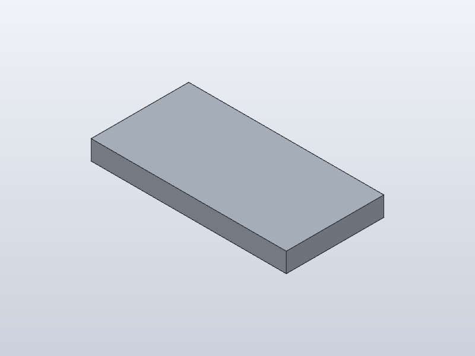

# Kontrol af modelbaserede materialeberegninger

Milepælen er gennemført med 10 faktisk gemte modelcases fra Solidcraft og BIMcraft. Tabellens beregninger bruger programudtrukket volumen og eksplicit valgte referencedata; de er kontrolleret mod analytiske volumener og den originale BR18-Excel-fil. Modellerne er homogene mængdeprøver, ikke færdigprojekterede konstruktioner.

| Case | Program | Volumen m³ | Vægt kg | Klimabidrag A1-A3, kg CO2-eq | Modelafrunding, ±kg |
| --- | --- | ---: | ---: | ---: | ---: |
| solid-wood | solidcraft | 0.05 | 23.5 | -33.2 | Ikke angivet som kvantiseret |
| solid-concrete | solidcraft | 0.12 | 269.52 | 28.92 | Ikke angivet som kvantiseret |
| solid-steel | solidcraft | 0.0016 | 12.56 | 20.58584 | Ikke angivet som kvantiseret |
| solid-glass | solidcraft | 0.00768 | 19.2 | 29.898429 | Ikke angivet som kvantiseret |
| solid-insulation | solidcraft | 0.135 | 2.025 | 6.610836 | Ikke angivet som kvantiseret |
| bimcraft-wood | bimcraft | 0.1 | 47 | -66.4 | 0.23500000000000001 |
| bimcraft-concrete | bimcraft | 0.096 | 215.616 | 23.136 | 1.123 |
| bimcraft-steel | bimcraft | 0.005 | 39.25 | 64.33075 | 3.9250000000000003 |
| bimcraft-glass | bimcraft | 0.006 | 15 | 23.358147 | 1.25 |
| bimcraft-insulation | bimcraft | 0.144 | 2.16 | 7.0515584 | 0.0075 |

Der er også kontrolleret særskilte resultater for C3, C4 og D: 40 modulberegninger i alt. Negativt A1-A3 for træ er det valgte kildedatasæts produktionsfase og må ikke præsenteres som et samlet negativt klimaaftryk. Andre livscyklusfaser og kildeforudsætninger skal medtages i den relevante metode; her holdes resultaterne særskilt.

## Ekstra kontroller

En faktisk Solidcraft-model af hvid ædelgran med 232mm bredde følger det publicerede USDA-eksempel: 8→11% fugt og tangentielt C=0,00245 giver 1,7052mm breddeændring. Retning og modelakse er eksplicit angivne antagelser. Gyldighedsinterval og kilde følger rapporten.

En original ÖKOBAUDAT-kilde med deklareret basis 1000kg kontrollerer skaleringsreglen. 859kg CO2-eq i det valgte modul bliver 429,5kg CO2-eq for 500kg materiale; kildens exchange meanAmount1 bruges ikke som nævner.

Manglende eller blandede materialer giver uafklarede resultater. BIMcrafts observerede afrunding 0,0048→0,005m³ er et særskilt regressionseksempel. Importadvarsler om udeladt indhold giver ikke samlet succes. Output kan ikke overskrive inputmodeller eller originalarkivet.

## Faktisk CAD-geometri



Billedet viser den faktisk oprettede Solidcraft-geometri, ikke en illustration genereret ud fra en beskrivelse. Modellen er et enkelt rektangulært kontrollegeme på 0,05m³; ingen mekanisk kapacitet eller fysisk funktion er prøvet.

## Rapportfiler og gentagelse

[Maskinlæsbar samlet rapport](../examples/reports/validation-summary.json), [beregningsguide](CALCULATIONS.md), [Solidcraft-modeller](../examples/models/solidcraft/) og [BIMcraft-modeller](../examples/models/bimcraft/).

```sh
python3 examples/run_controls.py
python3 -m unittest discover -s tests -v
```

Hele rapporter med kildelokation, input, metode, enhedskonvertering, modelhash og datavalg ligger under `examples/reports/`. Konkrete bindinger ligger i `examples/bindings/` og kan gennemgås før en beregning. Kontrollen viser korrektheden af disse eksplicitte scenarier; den etablerer ikke automatisk produktækvivalens for vilkårlige modeller.
