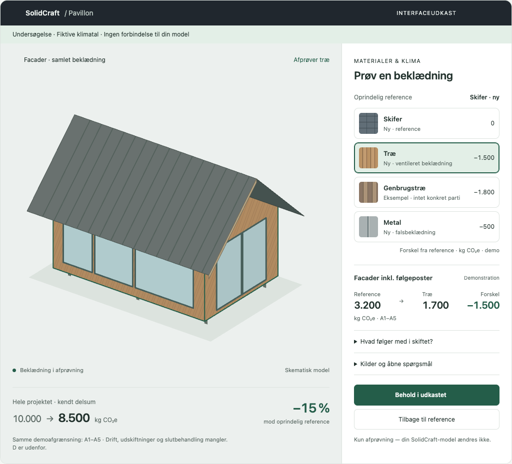

# Beklædningsvalg og klimaforskel

[Åbn HTML-udkastet](cladding-concept.html) ved at hente filen og åbne den i en browser. Det kræver ingen installation eller forbindelse til SolidCraft. GitHub viser selve kildekoden.

Dette er en **interaktiv designundersøgelse med fiktive klimatal**, ikke et SolidCraft-plugin, et beregningsværktøj eller en gengivelse af et konkret projekts resultater. Layoutet er et forslag og er ikke valideret ved en brugerprøve. Navnet SolidCraft identificerer den tiltænkte vært; dette er ikke en officiel SolidCraft-brugerfunktion.

Vælg skifer, træ, genbrugstræ eller metal. Illustrationen og sammenligningen ændres sammen. Den oprindelige reference bevares. **Behold i udkastet** markerer kun et valg i den åbne side; **Tilbage til reference** nulstiller afprøvningen. Intet gemmes til en CAD-model, og valget nulstilles ved genindlæsning.

Følgeposter og datamangler kan foldes ud. Alle materialer og bidrag er eksempler uden produktkilder; genbrugstræ er ikke et konkret lagerparti. A1–A5 er demoens illustrerede afgrænsning. Drift, udskiftninger og slutbehandling mangler; D er udenfor. Tallene dokumenterer ingen rangorden mellem materialerne.

## Hvad undersøger vi?

- Kan arkitekten afprøve beklædning og forstå delens samt projektets forskel uden manuelt at modellere om?
- Er omfang, reference og forslag tydelige, og kan man let gå tilbage?
- Er mangler synlige, mens følgeposter og kilder først fylder, når de åbnes?

En virkelig integration skal aflede passende mængder, overlap, spild, underlag, fastgørelser, transport og livscyklusbidrag. Det er ikke nok at skifte farve eller bruge en ny emissionsfaktor på den gamle løsnings mængder. Ukendte poster må ikke blive nul for at skabe en vinder.

## Kontrol og læring, 18. november 2026

Fire materialevalg, del-/projektsummer samt behold/tilbage er kontrolleret i en isoleret browser uden JavaScriptfejl. Lyse/mørke visninger og indholdsbredder på 1.024, 736 og 320 px er kontrolleret; det smalle layout stables uden vandret overflow.

Den første illustrations tegningsrækkefølge skjulte facadevalget bag taget. Det blev rettet efter visuel inspektion. En afvist previewoverskrivning viste desuden behovet for at stoppe kontrolkæden ved en renderfejl, så en gammel gengivelse ikke godkendes som ny.

Næste kontrol er brugerens forståelse af omfang, reference, del/projekt, mangler og fortrydelse. Teknisk fungerende knapper er ikke bevis for intuitiv betjening. Demoens hurtige lokale skift er heller ikke et målt svartidsløfte for CAD- og Rust-koblingen.

Se [integrationsundersøgelsen](../../docs/SOLIDCRAFT-INTEGRATION.md) for forskellen mellem mål, dokumenterede grænseflader og faktisk afprøvet funktion. Ingen netværkskald, eksterne afhængigheder, reservationer eller køb indgår i udkastet.
