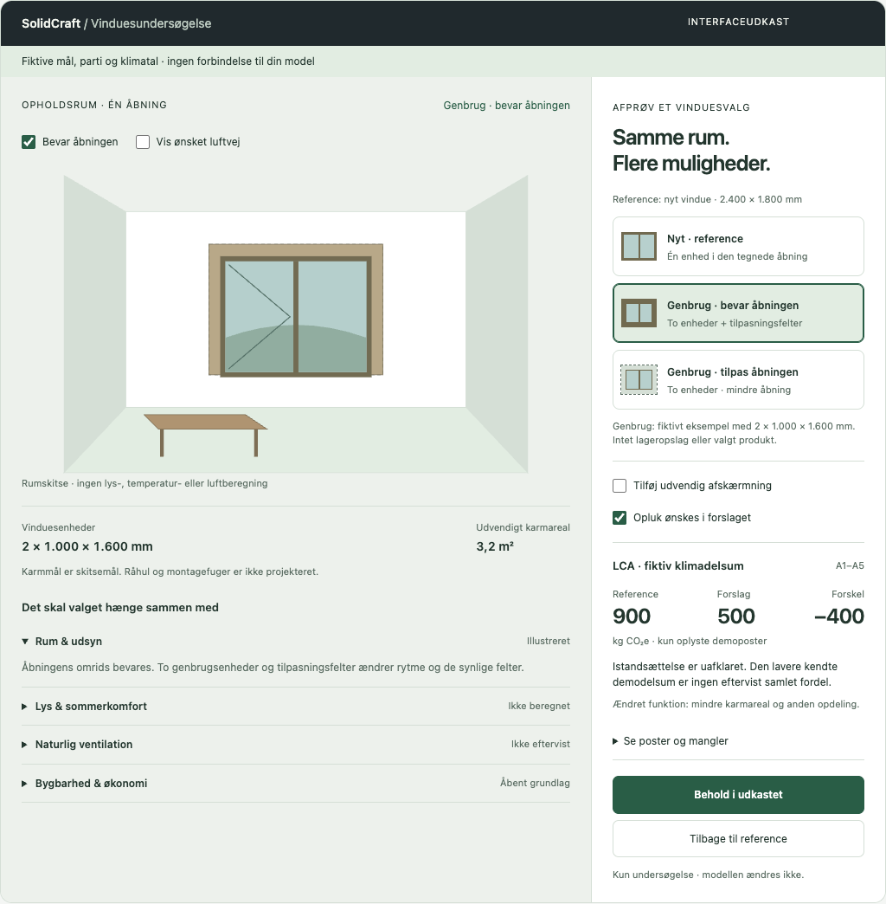

# Integreret design og LCA — visuelle undersøgelser

To interaktive udkast viser, hvordan materialer, arkitektoniske valg og beregningernes grundlag kan følges i samme arbejdsgang. **Alle klimatal, viste opbygninger, vinduesmål og genbrugspartier er fiktive.** Ingen CAD-, Rust-, lager- eller beregningsintegration er implementeret i disse filer.

Hent en HTML-fil og åbn den i en browser. GitHub viser kildekoden. Der kræves ingen installation, konto eller netværksforbindelse. Valg gælder kun i den åbne side og nulstilles ved genindlæsning. Navnet SolidCraft identificerer den tiltænkte vært; udkastene er ikke officielle SolidCraft-funktioner.

## Beklædning og klima — version 2

[Hent HTML-udkastet](cladding-concept.html)

Vælg mellem skifer, træ, genbrugstræ og metal. Illustration, lagvisning og del-/projektforskel følger valget. Referencepakken bevares under afprøvningen.

- **Bevar skiferudtrykket** er frivilligt. Afvigende alternativer kan stadig afprøves; genåbn ønsket for at beholde dem.
- En principiel lagvisning viser illustrative tykkelser og følgeposter. Det er ingen projekteret væg eller målfast tegning; 3D-illustrationen viser kun materialekarakter.
- Transportfølsomheden anvender samme faktor på facadernes reference og forslag. Montage og øvrige bygningsdele holdes faste.
- Istandsættelse ved genbrug står som uafklaret. En lavere kendt delsum bliver ikke til en eftervist samlet fordel.

**Behold** markerer et lokalt forslag med dets scenarie. Ændres scenariet, vises det gamle valg ikke som aktuelt. **Tilbage til reference** ændrer materialet; brugerens fastholdelse og transportantagelse bevares.

## Vinduesvalg, rum og faglige følger

[Hent HTML-udkastet](window-concept.html)

Sammenlign nyt referencevindue med to måder at bruge samme fiktive genbrugsenheder på: tilpasningsfelter i den bevarede åbning eller ændring af åbningen. Rumskitse, karmareal, klimadelsum og relevante fagspørgsmål følger valget.

- **Bevar åbningen** kan genåbnes, hvis arkitekten ønsker at beholde en variant med ændret åbning.
- Afskærmning og opluk er designønsker, ikke kendte produktegenskaber. Afskærmning får et eksplicit fiktivt materialetillæg; lys-/varmeeffekten er ikke beregnet.
- **Vis ønsket luftvej** ændrer kun visningen. Der tegnes ingen luftpil uden ønsket opluk. Pilen og oplukssymbolet efterviser ikke ventilation.
- Lys, sommerkomfort, naturlig ventilation, bygbarhed og økonomi vises med konkrete mangler; der er ingen opdigtede beståede fagberegninger.

Karmareal er ikke glasareal eller fri åbning. Genbrugsvarianterne ændrer funktion og opdeling; der vises derfor ingen procentvis besparelsespåstand. Istandsættelse, øvrig livscyklus, drift og pris er uafklarede. **Tilbage til reference** gendanner vindue, intet ekstra afskærmning og ønsket opluk; visningsvalg og arkitekturfastholdelse bevares.

## Kontrol og læring

Udviklet 18. november og publiceret i denne udgave 19. november 2026. Materiale-/vinduesvalg, demoaritmetik, fastholdelser, behold/tilbage og relevante mangler er browserkontrolleret. Lyse/mørke og smalle visninger er visuelt inspiceret; indholdsbredder på 1.024, 736 og 320 px er kontrolleret uden vandret overflow.

Vigtige læringspunkter:

- Visuel kontrol er nødvendig: den første tagillustration skjulte materialevalget; tegningsrækkefølgen blev rettet. En gammel preview må ikke godkendes efter en fejlet gengivelse.
- Scenarier skal påvirke den rette post. Transport og montage er skilt, så kun transport skaleres.
- Visningskontekst og designinput er forskellige. En luftpil ændrer ikke valget; ændret afskærmning eller opluk kan gøre et beholdt forslag forældet.
- Samme åbning er ikke samme karm-/glasareal eller funktion. Samme karmareal kan stadig give andre lysninger og rumlige følger.
- En interaktiv demo med pæne tal er ikke en LCA, en brugerprøve eller en teknisk eftervisning.

Næste vurdering er brugerens forståelse af omfang, reference, faglige følger, mangler og tilbageførsel. Ingen arkitektonisk kvalitets- eller klimavinder er dokumenteret.

Se [produktgrundlag og research](../../docs/DESIGN-TOOL.md) og [integrationsundersøgelsen](../../docs/SOLIDCRAFT-INTEGRATION.md). Ingen netværkskald, eksterne afhængigheder, modeldata, reelle projekttotaler, reservationer eller køb indgår.
