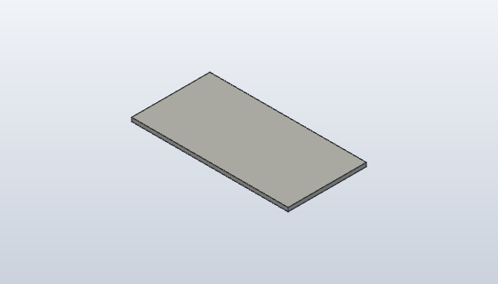

# Samme produkt i SolidCraft og BIMCraft

En plade på **1.000 × 500 × 20 mm** vejer **21 kg** med den deklarerede bruttodensitet for Lindners LinCrete-fiberbeton. Ved **24 mm** bliver vægten **25,2 kg**. I dette eksempel vælger vi produktet én gang. SolidCraft måler det lukkede CAD-legeme, BIMCraft måler sin importerede geometri, og begge sender mængden til samme materialeberegning.



| Pladetykkelse | Nettovolumen | Masse | Klimabidrag A1–A3 |
| --- | ---: | ---: | ---: |
| 20 mm | 0,010 m³ | 21,0 kg | 17,7944 kg CO₂e |
| 24 mm | 0,012 m³ | 25,2 kg | 21,3532 kg CO₂e |

Tallene gælder eksemplets ene rektangulære plade. Producentens specifikke deklaration er **EPD-LIN-20250235-CBA1-EN**. Den angiver en bruttodensitet på 2.100 kg/m³ og et produktionsbidrag på 847,351015163189 kg CO₂e pr. 1.000 kg produkt. For første række kan man selv gange 1 × 0,5 × 0,020 × 2.100 og derefter gange de 21 kg med 847,351015163189 / 1.000. [Originaldeklarationens maskinlæsbare data](https://oekobaudat.de/OEKOBAU.DAT/resource/processes/c54c16f6-4295-4749-bff0-ba7ed4bc9117?format=json&view=extended&version=00.01.000)

## Brug den fælles kobling fra en agent

Kør kommandoerne fra projektets rod. Installér Rust med Cargo samt SolidCraft CLI 0.44.0 og BIMCraft CLI 0.12.0. Første bygning installerer grundudgaven med de fire oprindelige datasæt. Rust-programmet kalder derefter modelprogrammernes egne kommandolinjer direkte.

```sh
cargo run --locked --bin ft-materials -- build --base-only
cargo run --locked --bin ft-materials -- assess examples/unified-workflow/revised/model.sc --software solidcraft --selection examples/unified-workflow/selection.json --transfer examples/unified-workflow/revised/transfer.json

cargo run --locked --bin ft-materials -- assess examples/unified-workflow/revised/model.bimc --software bimcraft --mesh-quantities --selection examples/unified-workflow/selection.json --transfer examples/unified-workflow/revised/transfer.json
```

Begge svar er JSON. `snapshot` angiver den præcise dataudgave. Under `selected_observations` findes egenskab, værdi, enhed, kildeadresse, kildeversion og placeringen i originalfilen. Under `elements` findes de målte mængder og beregninger. Et uafklaret resultat giver status `partial` og exitkode 2.

- **Materialevalget** gemmes i [selection.json](selection.json). Hver del henviser til et materialevalg. Flere dele kan bruge samme valg. Det består af kildebestemt materiale-ID, det aftalte navn i modellen, observations-ID'erne for densitet og klima samt en faglig begrundelse. Feltet `snapshot` fastholder en uforanderlig udgave. For at afprøve nye tal laver man en separat valgfil med det nye udgave-ID.
- **Koblingen mellem modeldele** gemmes i [revisionskortet](revised/transfer.json). Den, der laver overførslen, knytter et bestemt CAD-legeme til den konkrete importerede BIM-komponent og dens GUID. Kortet gemmer kontrolsummer for CAD-, GLB- og BIM-filen. Ved opslag kontrollerer værktøjet den valgte modelfils kontrolsum og elementernes identitet. Materialereferencen ligger i valgfilerne, mens GLB transporterer geometrien.
- **Efter en modelændring** skaber overførslen et nyt revisionskort ud fra den nye model og den nye BIM-import. De samme godkendte valg kan bruges igen, når alle dele svarer entydigt til hinanden. Manglende, nye eller flertydige identiteter kræver afklaring af kortet, før beregningen kan fortsætte. Dette forløb bruger lukkede SolidCraft-legemer og importerede generiske BIMCraft-komponenter med én understøttet meshform.

## Gentag hele forsøget

Byg de to dataudgaver. Eksemplet bruger den fastholdte grundudgave fra [materialevalget](selection.json) og den udvidede udgave, som anden kommando aktiverer. Brug eventuelt `--before` og `--after` med udgave-ID’er for at gentage med et bestemt par.

```sh
cargo run --locked --bin ft-materials -- build --base-only
cargo run --locked --bin ft-materials -- build
cargo run --locked --example unified-workflow -- --output output/unified-native
```

Kørslen bruger en ny tom mappe under `output/unified-native`. Brug fx `--output output/nyt-forsoeg` ved gentagelse. Kørslen gemmer originale CAD- og BIM-filer, alle revisionskort, programversioner og beregningssvar. Prøven læser tal direkte fra det originale BR18-regneark og den originale produktdeklaration. Hvis de mangler lokalt, henter den dem via de registrerede udgiveradresser og kontrollerer SHA-256.

Forløbet bygger pladen med SolidCraft CLI, ændrer tykkelsen i det eksisterende design og importerer begge versioner i hver sit BIMCraft-projekt. Derefter opdeler SolidCraft fysisk pladen i to legemer. Selvom den ene halvdel beholder det oprindelige navn, registreres delingen som uafklaret i begge programmer. Forsøget prøver også at bruge et gammelt revisionskort på en ændret model. Endelig genkører det [betonpladen og de to stålskinner](../integrated-workflow/README.md) med mængder fra begge programmer og et fælles sæt generiske BR18-referencer.

Under dataprøven anvendes den nye udgave og derefter den fastholdte gamle udgave. Den specifikke LinCrete-kilde er identisk i de to udgaver, og programmets kontrol sammenligner både tal, kildeversioner og placeringer. Resultaterne er samlet i [kontrolrapporten](verification.json).
