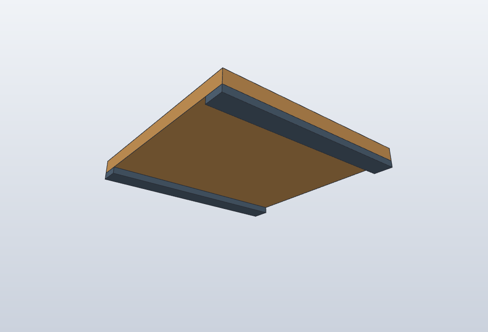

# Hvad vejer en hylde, og hvor meget bøjer den?

En kvadratisk krydsfinerplade hviler på to flade stålskinner. Lægger du en last midt på forkanten, kan du stille tre forskellige spørgsmål. Hvor meget materiale er der i modellen? Hvad er klimaaftrykket fra produktionen? Hvor langt bevæger en skinne sig under lasten? Her kan du følge de tre svar fra model og kilde til tal.



## Læs modellen

Hylden består af tre dele og måler 300 × 300 × 30 mm. SolidCraft indeholder mål og geometri. Den samme geometri er indlæst i BIMCraft, hvor hver del har et eget id. Rust-værktøjet måler hver af de tre dele i begge programmer og kontrollerer, at navn, materiale og volumen passer sammen. Til FieldCraft bruges en flademærket 3MF-fil af selve skinnen fra SolidCraft. [CAD- og BIM-modellerne med byggevejledning](cad/README.md)

| Del | Mål | Volumen pr. del | Densitet | Masse i alt |
| --- | --- | ---: | ---: | ---: |
| 2 skinner, S235-stål | 300 × 30 × 10 mm | 0,000090 m³ | 7.850 kg/m³ | 1,413 kg |
| 1 plade, ubehandlet krydsfiner | 300 × 300 × 20 mm | 0,001800 m³ | 480 kg/m³ | 0,864 kg |
| **Hele hylden** | | | | **2,277 kg** |

Massen ganget med tyngdeaccelerationen 9,81 m/s² giver en **egenvægt på 22,34 N**. Kilogram angiver masse, mens newton angiver den kraft, som massen udøver i tyngdefeltet.

## Hvad belaster materialerne klimaet med?

Stålreferencen giver 1.639 kg CO₂e pr. ton, og træpladens reference giver −599 kg CO₂e pr. m³. Stålmassen omregnes til ton, mens pladens målte volumen kan bruges direkte. Begge faktorer gælder produktionens moduler A1–A3.

| Produktionsbidrag | kg CO₂e |
| --- | ---: |
| Begge stålskinner | +2,316 |
| Krydsfinerpladen | −1,078 |
| **Samlet A1–A3** | **+1,238** |

Træ optager kulstof under væksten. Det er medregnet i pladens produktionsdata. I kildens særskilte scenarie for forbrænding efter brug bidrager pladen med **+1,337 kg CO₂e i modul C3**. Et helt livscyklusregnskab kræver også de øvrige relevante moduler og et valg af, hvad der faktisk sker efter brug. [Materialevalg, kildestatus og originaldeklarationer](materialekilder.md)

## Hvad regner vi på i statikken?

I forsøg A får forkanten en ekstra lodret kraft på **100 N**. Det svarer omtrent til tyngden af 10,2 kg. Lasten sidder midt mellem skinnerne. Vi antager, at pladen fordeler den ligeligt, så hver skinne får **50 N** ved den frie ende. Den anden ende er fuldt fastholdt ved væggen. FieldCraft deler skinnen op i små beregningselementer og regner på denne last.

I forsøg B regner vi desuden på hyldens egenvægt. De 22,34 N fordeles jævnt over længden og ligeligt mellem skinnerne. Her bruger vi bjælkeformler. Søjlerne viser størrelserne for **én** skinne.

| Bjælkeberegning pr. skinne | A · kun frontlast | B · frontlast og egenvægt |
| --- | ---: | ---: |
| Lodret kraft fra væggen | 50,00 N | 61,17 N |
| Bøjningsmoment ved væggen | 15,00 Nm | 16,68 Nm |
| Nominel bøjespænding i yderfiberen ved væggen | 30,00 MPa | 33,35 MPa |
| Største forskydningsspænding i rektangulært snit | 0,250 MPa | 0,306 MPa |
| Nedbøjning ved den frie ende | 0,857 mm | 0,929 mm |

Du kan efterregne forsøg A med en lommeregner. Et rektangulært tværsnit med bredde *b* og lodret højde *h* har inertimoment *I = bh³/12*, her 2.500 mm⁴. Med *F* = 50 N, *L* = 300 mm og stålets elasticitetsmodul *E* = 210.000 N/mm² bliver momentet *FL*, bøjespændingen *FLh/(2I)* og nedbøjningen *FL³/(3EI)*. For forsøg B lægges bidraget fra den jævnt fordelte last til. [MIT OpenCourseWare, bjælker med en punktlast eller fordelt last, trykt s. 268 / PDF-side 6](https://ocw.mit.edu/courses/1-050-solid-mechanics-fall-2004/resources/emech10_04/)

## Kontrollér resultatet med FieldCraft

FieldCraft bruger de elasticitetsdata, som Rust henter fra det fastlåste S235-kort, herunder Poissons tal på 0,30. Kraften fordeles over endefladen. Vi løser forsøg A to gange med forskellige størrelser på beregningselementerne og sammenligner endefladens gennemsnitlige lodrette forskydning med bjælketeorien. Væggens reaktionskraft og moment kontrolleres også.

| Resultat i forsøg A | Groft net, 90 elementer | Fint net, 720 elementer | Bjælketeori |
| --- | ---: | ---: | ---: |
| Nedbøjning ved fri ende | 0,8478 mm | **0,8508 mm** | 0,8571 mm |
| Trækspænding på skinnens overside halvvejs ude | 15,00 MPa | 15,00 MPa | 15,00 MPa |
| Lodret reaktion ved væggen | 50,00 N | 50,00 N | 50,00 N |
| Reaktionsmoment ved væggen, størrelse | 15,00 Nm | 15,00 Nm | 15,00 Nm |

Netstørrelsen er henholdsvis 10 mm og 5 mm. Nedbøjningen ændrer sig med 0,35 % mellem nettene. Det fine nets resultat ligger 0,74 % fra bjælketeorien. Spændingen er aflæst på oversiden ved x = 150 mm, y = 15 mm, z = 10 mm. Ved dette snit er bøjningsmomentet halvdelen af momentet ved væggen. I JSON er lodret forskydning nedad negativ, og væggens moment omkring y-aksen er −15 Nm. [FieldCrafts vejledning til lineær statik](https://github.com/tangency-labs/fieldcraft/blob/v0.8.1/docs/manual/structural/linear-static.md)

Begge metoder antager små deformationer og elastisk stål. Rapporten angiver nedbøjningen som andel af spændvidden i `tip_displacement_over_span` og markerer, hvis den nominelle bøjespænding når stålkortets flydegrænse på 235 MPa. Ved høje laster kan metoderne fortsat give ens svar uden at beskrive stålets faktiske respons.

For en virkelig hylde skal du også undersøge pladens bøjning på tværs, forbindelsen til skinnerne, skruernes udtræk og væggens materiale. Antagelsen om en fuldt fastholdt skinne erstatter hele vægfastgørelsen i dette eksempel. Eksemplet giver derfor en nedbøjning for skinnen under en valgt last. En tilladelig hyldelast kræver dokumentation for hele konstruktionen. [Forsøgsdata for skruer og træsamlinger](../../data/supplements/mechanics-connections/README.md)

## Kør selv

1. Hent projektet og åbn mappen `materialer/`. Installér Rust og programmernes kommandolinjer. Forsøget er afprøvet med SolidCraft 0.44.0, BIMCraft 0.12.0 og FieldCraft 0.8.1. [SolidCraft](https://solidcraft.io/download/) · [BIMCraft](https://github.com/IPedrax/BIMCraft/releases/tag/v0.12.0) · [FieldCraft](https://github.com/tangency-labs/fieldcraft/releases/tag/v0.8.1)
2. Installér materialeværktøjet og byg den offentlige dataudgave. Eksemplet vælger selv den udgave, der er angivet i materialevalget. På en server med en udvidet aktiv udgave bevarer `--no-activate` den eksisterende indstilling.

   ```sh
   cargo install --locked --path .
   ft-materials build --no-activate
   ```

3. Genkør hele beregningen. Programmet læser begge modeller, kontrollerer de otte kildeobservationer og starter FieldCraft for hvert af de to beregningsnet.

   ```sh
   cargo run --locked --release --example hyldekonsol
   ```

4. Prøv en samlet frontlast på 80 N. I den lineære model skal skinnens nedbøjning fra frontlasten også falde med 20 %. Hyldens masse og produktionsklima er de samme.

   ```sh
   cargo run --locked --release --example hyldekonsol -- --front-load-n 80
   ```

[Resultat fra vores kørsel med 100 N](resultat.json) · [Rust-beregningen](main.rs) · [Fastlåste observationer med enheder og kilder](materialevalg.json) · [FieldCraft-opskrift](fieldcraft/rail.json)

**Til din agent:** »Genkør hyldeeksemplet med 100 N og 80 N. Vis forskellen i skinnens nedbøjning, kontrollér at kræfterne er i ligevægt, og vis den originale kilde til stivheden. Hvilke oplysninger skal jeg skaffe om væg og fastgørelse, hvis jeg vil bruge resultatet i mit projekt?«
