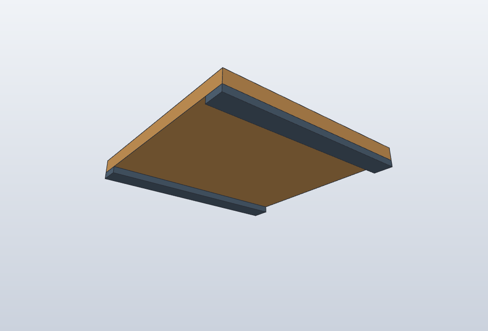

# CAD- og BIM-modeller af hylden



Hylden er 300 × 300 × 30 mm og har tre modellerede dele. Skinnerne møder pladens underside ved z = 10 mm. Væggen, skruer og beslag til fastgørelse er uden for modelgeometrien. I det statiske forsøg repræsenterer en fastholdelse ved skinnens x = 0 væggen.

| Del | Materialenavn i begge modeller | Udstrækning i CAD (mm) | Målt volumen fra hver model |
| --- | --- | --- | ---: |
| Rail_A | S235 | x 0–300, y 0–30, z 0–10 | 90.000 mm³ |
| Rail_B | S235 | x 0–300, y 270–300, z 0–10 | 90.000 mm³ |
| Shelf | Krydsfiner, ubehandlet | x 0–300, y 0–300, z 10–30 | 1.800.000 mm³ |

Åbn [hele hylden i SolidCraft](model.sc) eller [BIMCraft-modellen](model.bimc). SolidCraft giver målene fra hvert lukket legeme. BIMCraft har de samme tre dele som importerede komponenter med eget materialenavn på familiens geometriform. Overførslen sker gennem [GLB-filen](transfer.glb).

[Skinnen til FieldCraft](rail.3mf) er eksporteret fra **Rail_A i hele hyldemodellen** med SolidCrafts format `3mf-tagged`. Geometrien er i millimeter. Feltet `ft:face` angiver den oprindelige flade for hver trekant. Den fastholdte ende ved x = 0 har indeks 2, og den belastede ende ved x = 300 mm har indeks 4. [Samme skinne som redigerbar SolidCraft-fil](rail.solidcraft).

## Gentag oprettelsen og sammenlign målingerne

Kør fra repositoryets `materialer/` med SolidCraft CLI 0.44.0, BIMCraft CLI 0.12.0 og `ft-materials`. Vælg en ny mappe til de genskabte modeller. BIMCraft tildeler nye GUID’er ved hver frisk import. Navnene `Rail_A`, `Rail_B` og `Shelf` forbinder delene i denne model.

```sh
examples/hyldekonsol/cad/build.sh /tmp/min-hyldemodel
ft-materials extract /tmp/min-hyldemodel/model.sc --software solidcraft
ft-materials extract /tmp/min-hyldemodel/model.bimc --software bimcraft --mesh-quantities
```

Sammenlign `volume_m3` pr. del via `source_ref.body_name` i CAD-udtrækket og `source_ref.family_name` i BIM-udtrækket. Materiale-CLI’et beregner BIM-volumen fra den lukkede trekantsoverflade. SolidCrafts originale mål, BIM-familien og materialekilderne kan således kontrolleres hver for sig. [Geometrikommandoerne i SolidCraft](assembly.json) · [Import og materialetildeling i BIMCraft](import.bimscript) · [Det samlede eksempel](../README.md)
