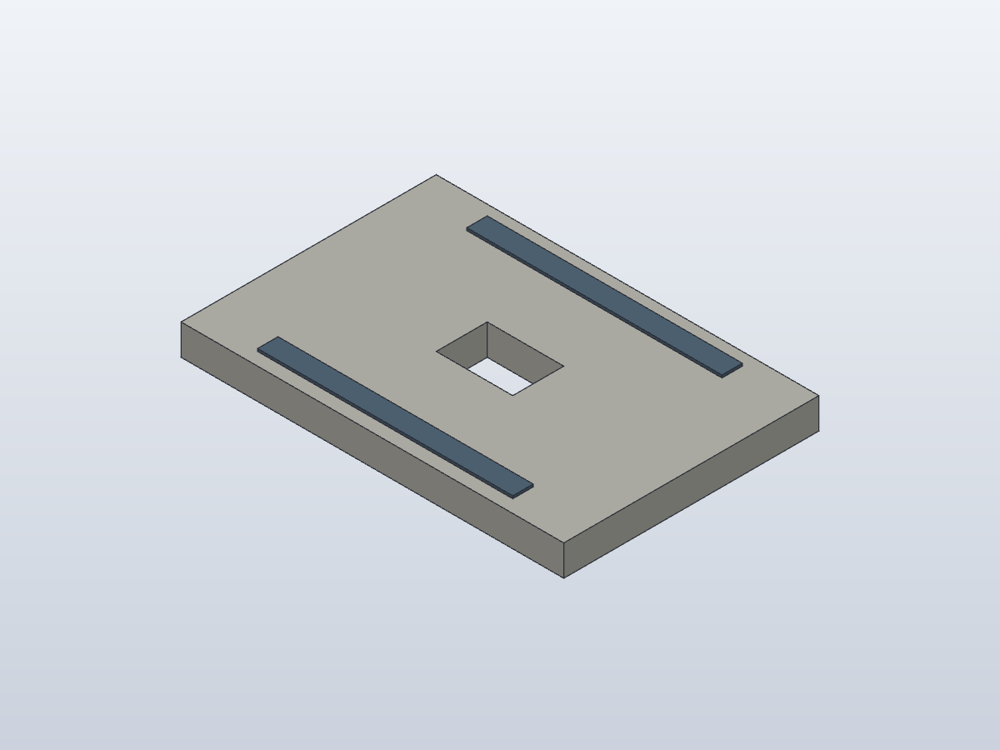

# Solidcraft → BIMcraft → materialeværktøj — afprøvet samlet forløb

**Forsøget består.** Den samme geometri oprettes i Solidcraft, overføres gennem GLB til BIMcraft og beregnes med materialeværktøjet. Den bliver ikke tegnet igen i BIMcraft, og BIM-mængderne kopieres ikke fra CAD-mængderne. En ændring i CAD er gennemført og hele forløbet gentaget.

## Modellen og resultatet

Modellen består af **tre dele**: en betonplade på 1.500 × 1.000 × 100 mm med en gennemgående udsparing på 300 × 200 mm samt to stålskinner på hver 1.000 × 80 × 10 mm. Samlet ydre højde er 110 mm. I anden version ændres pladen til 120 mm; skinnernes placering følger CAD-parameteren, og samlet højde bliver 130 mm.



| Kontrolleret størrelse | Før: 100 mm plade | Efter: 120 mm plade |
| --- | ---: | ---: |
| Nettovolumen, beton | 0,144 m³ | 0,1728 m³ |
| Stålvolumen, begge skinner | 0,0016 m³ | 0,0016 m³ |
| Beregnet masse | 335,984 kg | 400,6688 kg |
| Beregnet klima, kun A1–A3 | 55,28984 kg CO₂e | 62,23064 kg CO₂e |
| Dele i BIMcraft | 3 | 3 |

Ændringen er **+64,6848 kg** og **+6,9408 kg CO₂e i A1–A3**. Solidcraft- og BIMcraft-forløbene stemmer med den uafhængige reference. Tallene er mængde- og integrationskontroller med udtrykkeligt valgte generiske materialereferencer. Skinnerne er mængdeprøver; forsøget fastslår ikke en faktisk leverance, produktækvivalens eller en bærende konstruktion.

## Hvad agenten gør

1. Opretter tre lukkede legemer og udsparingen med `solidcraft-cli`. Den reviderede version bruger `parameters.change` på den eksisterende CAD-model.
2. Eksporterer den faktiske geometri til GLB. BIMcraft læser filen med `import_mesh` og opretter tre generiske komponenter.
3. Bekræfter de valgte materialereferencer gennem et eksplicit [materialekort](material-manifest.json). Hver versions overførselskort binder CAD-, GLB- og BIM-kontrolsummer sammen med kropsnavne, BIM-GUID’er og materiale-ID’er.
4. Kalder materialeværktøjet på BIM-modellen med `--mesh-quantities`. Det læser trekantsfladerne fra BIMcrafts `family`-kommando og beregner nettovolumen. Kontroller af lukning, fladeretning og sammenhæng udføres før beregning. Udsparingen er derfor med i nettomængden.
5. Kører `assess` med eksplicitte kildeobservationer for densitet og GWP. Samme beregning køres fra Solidcrafts egne målte volumener til sammenligning.
6. Eksporterer BIM-modellen til GLB og lader Solidcraft måle returmodellen. Alle tre dele er lukkede; placering og volumen bevares inden for de angivne tolerancer.
7. Gentager forløbet med den ændrede CAD-model. Hver revision får et nyt BIM-projekt, fordi `import_mesh` tilføjer komponenter ved gentagen import.

Hele styringen sker gennem CLI og gemte JSON-filer. Der kræves ingen manuelle klik i de to programmer.

## Materialer og originale kilder

Original: [BR18 tabel 7, 2025](https://www.bygningsreglementet.dk/media/1o1nnozd/tabel-7-2025.xlsx), bevaret i [originalfilen hos udgiveren](https://www.bygningsreglementet.dk/media/1o1nnozd/tabel-7-2025.xlsx). Materialeværktøjets resultater bevarer kilde-URL, SHA-256, celler og referencegrundlag.

| Reference | Originale celler | Densitet | GWP A1–A3 |
| --- | --- | ---: | ---: |
| Fabriksbeton C25/30, X0/XC1 · B1433 | Sheet1, række 25: D/E/I/J/K/L | 2.246 kg/m³ | 241 kg CO₂e pr. 1 m³ |
| Konstruktionsstål, valsede profiler, lille forarbejdning · D1591 | Sheet1, række 129: D/E/I/J/K/L | 7.850 kg/m³ | 1.639 kg CO₂e pr. 1 ton |

Den uafhængige reference læser tallene direkte fra original Excel og beregner betonvolumen som `(1,5 × 1,0 − 0,3 × 0,2) × tykkelse`. Den læser ikke de forventede svar fra materialedatabasen eller BIM-udtrækket. Der summeres alene de tre deles samme GWP-indikator i A1–A3 for dette referencescenarie; ingen øvrige livscyklusmoduler indgår.

## Hvad bliver overført?

I netop denne model følger de fulde beton- og stålnavne med som **visuelle GLB-materialenavne**. GLB-filen indeholder ikke de valgte database-ID’er, densitetsobservationer, klimafaktorer eller godkendte beregningsbindinger. Materialekortet og de hashbundne bindingsfiler angiver dette faglige valg. En farve eller enslydende tekst godkendes ikke automatisk som et materialeprodukt.

Returmodellen i Solidcraft har trekantsgeometri, BIM-element-ID’er som kropsnavne og fysisk materiale `Default`. Returkontrollen gælder derfor geometri og placering. Den returnerede models standardvægt bruges ikke som fysisk resultat. Solidcrafts oprindelige parametre og konstruktionshistorik bevares i `.sc`-originalen og følger ikke med gennem GLB.

## Kontroller og begrænsninger

- 12 sæt af delberegninger er kontrolleret: tre dele × to modelversioner × to programmer, hver med volumen, masse og A1–A3.
- En særskilt kontrol afkoder GLB-positioner/-indekser og sammenholder alle 32 pladetrekanter og 12 trekanter pr. skinne med friske BIMcraft-familieudtræk. Begge versioner matcher ved en afrunding til 0,0000001 mm.
- Alle seks returnerede delmodeller er lukkede. Største målte boundingbox-afvigelse er cirka 0,000012 mm; største relative volumenafvigelse er cirka 0,000042 %. Forsøgets acceptgrænser er 0,002 mm for verdenskoordinater og 0,0002 % relativt for volumen.
- Manglende materialebinding giver i begge versioner delvis status uden vægt- eller klimatal. Gamle bindingsfiler afvises mod begge reviderede modeller med `model_changed`.
- Revisionen har fortsat tre komponenter. Import tilføjer ikke gamle og nye dele i samme projekt i dette forløb.
- Den nye meshfunktion er et aktivt tilvalg. Den understøtter én lukket, sammenhængende trekantsskal i en uparameteriseret generisk familie med kendt referenceplan og stiv placering. Åbne skaller, indbyrdes forkert vendte flader, flere skaller, hulrumsformer, betinget synlighed og ikke-understøttet familiekontekst bliver uafklarede. Der kontrolleres ikke generelt for selvskæring eller CAD-tesselleringens afvigelse fra krumme originalflader.
- De overførte dele er generiske BIM-komponenter. Forsøget dokumenterer ikke konvertering til parametriske BIM-vægge/dæk, automatisk synkronisering eller sammenfletning af vilkårlige projekter.

Den samlede automatiske testsuite består med **54 tests**, herunder 13 nye kontroller af meshfunktionen. Installerede versioner i forsøget: Solidcraft CLI 0.44.0 og BIMcraft CLI 0.12.0.

## Kør forsøget igen

Kør kommandoerne fra mappen `materialer`.

```sh
python3 examples/integrated-workflow/run.py
python3 examples/integrated-workflow/independent-check.py
python3 -m unittest discover -s tests -q
```

Første kommando gendanner eksempelmodeller, udtræk, bindinger, beregninger og billeder i denne mappe. Den skriver `running`, `failed` eller `passed` til `verification.json`, så et mislykket genforsøg ikke efterlader en gammel succes som aktuel status. Anden kommando læser modellerne igen, sammenligner trekantsgeometrien og gemmer sin uafhængige evidens. Den er afgrænset til dette kendte GLB-/placeringsforløb.

Brug det nye mængdetilvalg direkte på en understøttet BIM-model:

```sh
python3 materials.py extract examples/integrated-workflow/base/model.bimc --software bimcraft --mesh-quantities --out /tmp/bim-maengder.json
python3 materials.py assess examples/integrated-workflow/base/model.bimc --software bimcraft --mesh-quantities --bindings examples/integrated-workflow/base/bim-bindings.json --out /tmp/bim-materialer.json
```

## Filer og efterprøvelse

| Fil / mappe | Indhold |
| --- | --- |
| [verification.json](verification.json) | Samlet resultat, før/efter, kontrolsummer, returkontroller og grænser |
| [independent-evidence/summary.json](independent-evidence/summary.json) | Uafhængigt kontrollerede trekanter, mængder og fejlsituationer |
| [command-log.json](command-log.json) | Faktiske kommandoer, exitkoder og målt CLI-tid |
| [material-manifest.json](material-manifest.json) | Valgte referencer og modeldefinition |
| [create-solidcraft.json](create-solidcraft.json) / [revise-solidcraft.json](revise-solidcraft.json) | De faktisk udførte CAD-kommandoer |
| `base/` / `revised/` | `.sc`, `.bimc`, GLB, billeder, overførselskort, udtræk, bindinger, kildebaserede resultater og analytiske referencer |
| `logs/` | Komplet stdout/stderr fra hvert trin; forventede fejl er registreret |
| [file-manifest.json](file-manifest.json) | Dossierfiler og anvendt produktionskode med SHA-256 |

