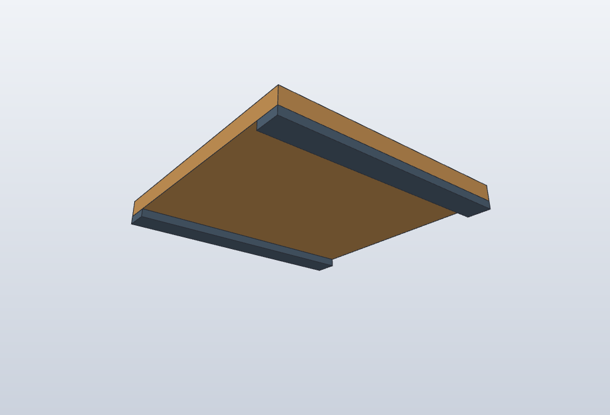

# Hylden fra materialevalg til statisk beregning

Hvad vejer en hylde, hvad koster produktionen i klimaaftryk, og hvor meget giver hylden efter, når du lægger noget på den? Du kan følge svarene her uden at installere programmer. Hvis du vil gentage forsøget, ligger modeller, materialekilder og Rust-beregning sammen i projektet. [Åbn eksempel og resultatfiler](../../examples/hyldekonsol/README.md)



## Hvor kommer oplysningerne fra?

1. **SolidCraft tegner formen.** Pladen måler 300 × 300 × 20 mm. Hver stålskinne måler 300 × 30 × 10 mm. Det er den lodrette højde på 10 mm, der indgår i beregningen af skinnens bøjning. [Modelfiler og mål](../../examples/hyldekonsol/cad/README.md)
2. **BIMCraft holder styr på delene.** Det indlæser geometrien fra SolidCraft. Pladen og de to skinner kan genfindes hver for sig. Materialeværktøjet måler alle tre volumener i begge modeller og kontrollerer dem mod hinanden. [Sådan hænger programmerne sammen](../../docs/PROGRAMMER.md)
3. **Materialeværktøjet henter tallene.** Det slår otte kildeobservationer op i en fast dataudgave. En kubikmeter stål er tungere end en kubikmeter krydsfiner. Densiteterne omsætter modellens volumener til kg. Klimaaftrykket for stål er opgivet pr. ton og for krydsfiner pr. kubikmeter. [De valgte materialer og originalkilder](../../examples/hyldekonsol/materialekilder.md)
4. **FieldCraft beregner skinnens deformation.** Én af de to ens skinner eksporteres fra SolidCraft som en flademærket 3MF-fil. Den ene endeflade holdes fast, og den anden får en nedadrettet kraft. En beregning med bjælketeori giver et uafhængigt tal at sammenligne med. [Se last, materiale og målepunkter](../../examples/hyldekonsol/fieldcraft/README.md)

## Hvor tung er den, og hvad er klimaaftrykket?

Pladen vejer 0,864 kg og skinnerne tilsammen 1,413 kg. Hylden har derfor en **masse på 2,277 kg** og udøver en **tyngdekraft på 22,34 N**. Produktionsmodulerne A1–A3 giver samlet **1,238 kg CO₂e**. Stålets bidrag er positivt, og træets er negativt, fordi det oplagrede kulstof tæller med i denne fase. I kildens forbrændingsscenarie giver træpladen yderligere 1,337 kg CO₂e i affaldsbehandlingen, modul C3. Du kan se hvert bidrag og dets enhed i regneeksemplet. [Mængder og klimaberegning](../../examples/hyldekonsol/README.md#hvad-belaster-materialerne-klimaet-med)

## Hvad betyder en nedbøjning på 0,85 mm?

Forestil dig en ekstra last på 100 N midt på forkanten. Vi antager, at pladen fordeler den ligeligt mellem de to skinner. Hver skinne får 50 N ved enden. Ved væggen skal der derfor være en opadrettet reaktion på 50 N. Med 0,30 m mellem væg og last er momentets størrelse 15 Nm. Det fortæller, hvor stor en drejende påvirkning vægfastgørelsen skal optage fra denne last på én skinne.

| Resultat pr. skinne | Bjælketeori | FieldCraft med fint net |
| --- | ---: | ---: |
| Nedbøjning ved forkanten | 0,857 mm | 0,851 mm |
| Trækspænding på oversiden midt på skinnen | 15,0 MPa | 15,0 MPa |
| Lodret reaktion ved væggen | 50,0 N | 50,0 N |

FieldCraft opdeler skinnen i små elementer. Da vi øgede antallet fra 90 til 720, ændrede nedbøjningen sig med 0,003 mm. Det fine net ligger 0,74 % fra bjælketeorien. Et andet lasttilfælde medtager også pladens og skinnernes egenvægt fordelt over længden. For det tilfælde giver håndberegningen **0,929 mm**. [Se resultaterne fra begge net og begge lasttilfælde](../../examples/hyldekonsol/README.md#hvad-regner-vi-på-i-statikken)

## Hvad kan du bruge svaret til?

Du kan sammenligne to antagelser om frontlast på samme model og se, hvilken forskel det gør. I en virkelig hylde kan væggen give efter, en skrue kan løsne sig, og træpladen kan bøje på tværs. Eksemplet modellerer skinnens respons ved en ideelt fast væg. En vurdering af hele hyldens bæreevne kræver også oplysninger om plade, væg og samlinger. [Forsøgsdata om fastgørelser](../../data/supplements/mechanics-connections/README.md)

## Prøv selv eller brug din agent

Efter installation af de tre programmer og materialeværktøjet køres følgende fra mappen `materialer/`. Første kommando opretter den offentlige dataudgave, som materialevalget henviser til. De næste to gentager forsøget med henholdsvis 100 og 80 N.

```sh
ft-materials build --no-activate
cargo run --locked --release --example hyldekonsol
cargo run --locked --release --example hyldekonsol -- --front-load-n 80
```

Med 80 N falder nedbøjningen fra frontlasten med 20 %. Masse og produktionsklima er uændret. Du kan bede din agent om følgende. »Kør begge laster. Vis hvor forskellen kommer fra, find kilden til stålets stivhed, og fortæl mig, hvad vi ville skulle undersøge i en eksisterende væg.« [Installation og trinvis vejledning](../../examples/hyldekonsol/README.md#kør-selv) · [Maskinlæsbart resultat for 100 N](../../examples/hyldekonsol/resultat.json)
