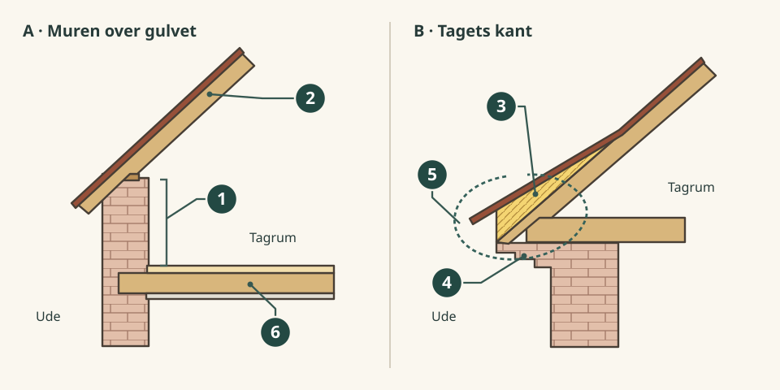

# Illustreret fagordbog · Når tag og ydermur mødes

Du står på gaden, kigger op og ser, at taget bliver fladere lige over muren. Hvad kalder man det lille svaj? Eller tømreren har skrevet *trempel* på en tegning. Hvor skal du kigge? Her kan du finde ordet ud fra formen og formen ud fra ordet.

**[Hent det klikbare tegneark (PDF)](tagsnit.pdf?raw=true)** og tryk på et nummer for at læse om detaljen. Du kan også bruge tegningen og nummerlisten her på siden.

**Kender du ordet?** [Bjælkelag](#bjælkelag) · [Gesims](#gesims) · [Skalk og opskalkning](#skalk) · [Spær](#spær) · [Tagfod](#tagfod) · [Trempel](#trempel)

## Find detaljen på tegningen

Et snit viser huset, som hvis du skar lodret igennem det. Udenfor er til venstre på begge tegninger. A viser, hvordan et tag kan løftes over gulvet. B viser tagkanten på et andet hus. Tegningerne er forenklede og uden mål.

| Hvis du kan pege på … | Slå op |
| --- | --- |
| Den lave væg, der løfter taget over gulvet i A | [Punkt 1](#trempel) |
| Det lange, skrå stykke træ under tagfladen i A | [Punkt 2](#spær) |
| Den skraverede kile dér, hvor tagfladen skifter hældning i B | [Punkt 3](#skalk) |
| Murstenene, der danner en lille trappe ud fra muren i B | [Punkt 4](#gesims) |
| Hele området ved tagets møde med ydermuren i B, vist med stiplet bue | [Punkt 5](#tagfod) |
| Det vandrette tømmer under gulvbrædderne i A | [Punkt 6](#bjælkelag) |

## Trempel

**[A · punkt 1](#find-detaljen-på-tegningen).** Følg ydermuren op forbi tagetagens gulv. Det lave vægstykke, som løfter taget herfra, er en *trempel*. Det giver mere højde langs loftsrummets yderkant. Her har vi tegnet den i murværk. En trempel kan også bestå af træstolper med en vandret bjælke ovenpå. Klammen viser vægstykket fra gulvet op til tagets understøtning. [Jeanne Brüel, *Taget*, s. 11 om trempeltage](https://gi.dk/media/adcp1scx/kompendium-med-temaet-tag.pdf#page=11) · [Søren Kochs tegning af en trempel i træ, PDF-s. 52](https://danskbyggeskik.dk/publikationer/ordbog_fagudtryk_fra_det_traditionelle_byggeri.pdf#page=52)

## Spær

**[A · punkt 2](#find-detaljen-på-tegningen).** Det skrå stykke tømmer bærer tagets underlag og dækning. Sådan et stykke kaldes et *spær*. Gå langs ydersiden af huset i tankerne, og du kommer forbi en række spær. I snittet ser du kun ét af dem. [Jeanne Brüel, *Taget*, s. 1 om tagets opbygning](https://gi.dk/media/adcp1scx/kompendium-med-temaet-tag.pdf#page=1) · [Søren Koch, opslaget *Spær*, PDF-s. 45](https://danskbyggeskik.dk/publikationer/ordbog_fagudtryk_fra_det_traditionelle_byggeri.pdf#page=45)

## Skalk

**[B · punkt 3](#find-detaljen-på-tegningen).** En *skalk* er her en trækile oven på den nederste del af spæret. Følg kilen udefra og ind. Den er tyk ved tagkanten og tynder ud op ad spæret. Derfor får tagfladen en fladere hældning nederst og kan nå ud over murens fremspring. Det synlige svaj kaldes *opskalkning* og omtales også som *skalk*. Fra gaden kan du se svajet. Selve kilen kan du lede efter på en detaljetegning eller ved et synligt spær. [Søren Kochs tegning af skalken, PDF-s. 42](https://danskbyggeskik.dk/publikationer/ordbog_fagudtryk_fra_det_traditionelle_byggeri.pdf#page=42) · [Jeanne Brüel, *Taget*, s. 26 om det synlige svaj](https://gi.dk/media/adcp1scx/kompendium-med-temaet-tag.pdf#page=26)

## Gesims

**[B · punkt 4](#find-detaljen-på-tegningen).** Se på de øverste rækker mursten. De springer frem og danner et vandret bånd langs facaden. Det er husets *gesims*. I denne tegning kan du kende den på trappetrinnene under tagkanten. En gesims kan også have en formet profil. [Jeanne Brüel, *Taget*, s. 26, opslaget *Gesims*](https://gi.dk/media/adcp1scx/kompendium-med-temaet-tag.pdf#page=26)

## Tagfod

**[B · punkt 5](#find-detaljen-på-tegningen).** Den nederste del af taget, hvor tag og ydermur mødes, kaldes *tagfoden*. Den stiplede bue udpeger et område. Skal du beskrive noget for en kollega, kan du først angive stedet – ved tagfoden – og derefter pege på den konkrete del, eksempelvis skalken eller murens gesims. [Søren Koch, opslagene *Tagfod* og *Tagskæg*, PDF-s. 50](https://danskbyggeskik.dk/publikationer/ordbog_fagudtryk_fra_det_traditionelle_byggeri.pdf#page=50) · [Jeanne Brüel, *Taget*, s. 26](https://gi.dk/media/adcp1scx/kompendium-med-temaet-tag.pdf#page=26)

## Bjælkelag

**[A · punkt 6](#find-detaljen-på-tegningen).** Under gulvbrædderne ligger en række vandrette bjælker, som bærer gulvet. Tilsammen kaldes de et *bjælkelag*. Snittet følger én af bjælkerne ind fra ydermuren. Gulvets overside hjælper dig også med at finde den nederste ende af tremplen ved punkt 1. [Søren Kochs tegning af bjælker, gulvbrædder og mur, PDF-s. 7](https://danskbyggeskik.dk/publikationer/ordbog_fagudtryk_fra_det_traditionelle_byggeri.pdf#page=7)

## Tag arket med ud

Prøv i par. Den ene peger på punkt 3 uden at sige ordet. Den anden finder navnet og forklarer, hvad man kan se fra gaden. Byt så retning. Bed din makker finde *tremplen* og vise, hvor på tegningen den begynder og ender.

Fremtidens Tegnestue har tegnet snittene til denne fagordbog. Du kan bruge og tilpasse teksten og tegningerne med projektets licens. [Hent tegningen som SVG](tagsnit.svg) · [Licens](../../LICENSE) · [Arbejdsark til den første besigtigelse](../oplaeg/forste-besigtigelse.md)
