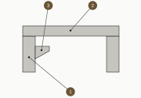
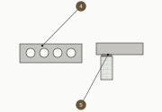
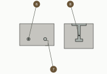

# Beton, stål og montage

Følg lastens vej fra dæk til understøtning. I de små snit kan du se detaljer, som er skjult efter støbningen.

[Klikbart tegneark (PDF)](ark.pdf?raw=true) · [Offline browserark](ark.html?raw=true) · [SolidCraft-model](model.sc) · [Tegneopskrift](model.json) · [Hele fagordbogen](../OVERSIGT.md)

Principsnit og opstalter uden mål. Numrene følger delene på tegningen.

## Ramme · søjle, drager og udkraget konsol

### Søjle

**[Punkt 1 på tegningen](snit-1.svg).** Den lodrette del modtager last fra de dele, der hviler på den. Her bærer to søjler en drager. [CRH · Projekteringsprincipper · PDF-s. 6](https://crhconcrete.dk/wp-content/uploads/2019/11/CRH-armeringsprincipper-2018-1.pdf#page=6)

### Drager

**[Punkt 2 på tegningen](snit-1.svg).** En bærende bjælke, der spænder mellem understøtninger. Her går drageren fra søjle til søjle. [BYG-ERFA · Drager](https://byg-erfa.dk/ordbog/drager)

### Konsol

**[Punkt 3 på tegningen](snit-1.svg).** Den korte fremspringende understøtning giver en anden del et sted at hvile. På tegningen sidder den på siden af søjlen. [CRH · Projekteringsprincipper · PDF-s. 15](https://crhconcrete.dk/wp-content/uploads/2019/11/CRH-armeringsprincipper-2018-1.pdf#page=15)

## Dæk i tværsnit og ende på leje i længdesnit

### Huldæk

**[Punkt 4 på tegningen](snit-2.svg).** Et dækelement med langsgående kanaler. I tværsnittet ses kanalerne som huller; ved enden bæres elementet på sit leje. [CRH · Huldæk](https://crhconcrete.dk/betonelementer/produktsortiment/daekelementer/huldaek/)

### Lejeflade

**[Punkt 5 på tegningen](snit-2.svg).** Kontaktfladen, hvor dækkets reaktion overføres til understøtningen. Her peger nummeret på oversiden af lejet. [CRH · Projekteringsprincipper · PDF-s. 15](https://crhconcrete.dk/wp-content/uploads/2019/11/CRH-armeringsprincipper-2018-1.pdf#page=15)

## Indstøbt stål · snit gennem en armeret del og et særskilt anker

### Armering

**[Punkt 6 på tegningen](snit-3.svg).** Stål indstøbt i betonen. Her skærer snittet gennem to langsgående stænger, så de ses som små cirkler. [CRH · Projekteringsprincipper · PDF-s. 2](https://crhconcrete.dk/wp-content/uploads/2019/11/CRH-armeringsprincipper-2018-1.pdf#page=2)

### Dæklag

**[Punkt 7 på tegningen](snit-3.svg).** Betonlaget fra overfladen til det nærmeste armeringsstål. Her ligger det mellem stangens underkant og betonens underside. [CRH · Projekteringsprincipper · PDF-s. 2](https://crhconcrete.dk/wp-content/uploads/2019/11/CRH-armeringsprincipper-2018-1.pdf#page=2)

### Anker

**[Punkt 8 på tegningen](snit-3.svg).** En indstøbt ståldel kan fastholde en forbindelse til betonen. Her ses et princip med plade, skaft og forstørret ende. [Peikko · Indstøbt ankerplade](https://www.peikko.dk/produkter/product/threlda/)
