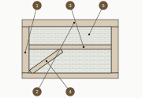
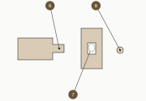
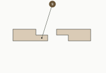

# Træ, bindingsværk og samlinger

Find først delene i et helt vægfag. Se derefter, hvordan to stykker træ kan gribe ind i hinanden.

[Klikbart tegneark (PDF)](ark.pdf?raw=true) · [Offline browserark](ark.html?raw=true) · [SolidCraft-model](model.sc) · [Tegneopskrift](model.json) · [Hele fagordbogen](../OVERSIGT.md)

Principsnit og opstalter uden mål. Numrene følger delene på tegningen.

## Et vægfag set udefra

### Stolpe

**[Punkt 1 på tegningen](snit-1.svg).** Det lodrette tømmer afgrænser faget og fører last ned mod foden. [Søren Koch · Fagudtryk fra det traditionelle byggeri · PDF-s. 47](https://danskbyggeskik.dk/publikationer/ordbog_fagudtryk_fra_det_traditionelle_byggeri.pdf#page=47)

### Rem

**[Punkt 2 på tegningen](snit-1.svg).** Det vandrette tømmer øverst binder stolperne sammen langs væggen. [Søren Koch · Fagudtryk fra det traditionelle byggeri · PDF-s. 39](https://danskbyggeskik.dk/publikationer/ordbog_fagudtryk_fra_det_traditionelle_byggeri.pdf#page=39)

### Løsholt

**[Punkt 3 på tegningen](snit-1.svg).** Det vandrette stykke mellem to stolper deler faget i højden. [Søren Koch · Fagudtryk fra det traditionelle byggeri · PDF-s. 32](https://danskbyggeskik.dk/publikationer/ordbog_fagudtryk_fra_det_traditionelle_byggeri.pdf#page=32)

### Skråbånd

**[Punkt 4 på tegningen](snit-1.svg).** Det skrå tømmer gør vægfaget stivere mod sideværts bevægelse. [Søren Koch · Fagudtryk fra det traditionelle byggeri · PDF-s. 43](https://danskbyggeskik.dk/publikationer/ordbog_fagudtryk_fra_det_traditionelle_byggeri.pdf#page=43)

### Tavl

**[Punkt 5 på tegningen](snit-1.svg).** Det udfyldte felt mellem tømmerstykkerne, her vist som murværk. [Søren Koch · Fagudtryk fra det traditionelle byggeri · PDF-s. 50](https://danskbyggeskik.dk/publikationer/ordbog_fagudtryk_fra_det_traditionelle_byggeri.pdf#page=50)

## Adskilte dele · tap, taphul og låsning

### Tap

**[Punkt 6 på tegningen](snit-2.svg).** Den smallere ende stikker ud fra det ene træstykke og passer ind i hullet i det andet. [Søren Koch · Fagudtryk fra det traditionelle byggeri · PDF-s. 50](https://danskbyggeskik.dk/publikationer/ordbog_fagudtryk_fra_det_traditionelle_byggeri.pdf#page=50)

### Taphul

**[Punkt 7 på tegningen](snit-2.svg).** Udsparingen modtager tappen. Her ses åbningen på fladen af det modtagende stykke. [Søren Koch · Fagudtryk fra det traditionelle byggeri · PDF-s. 50](https://danskbyggeskik.dk/publikationer/ordbog_fagudtryk_fra_det_traditionelle_byggeri.pdf#page=50)

### Dyvel

**[Punkt 8 på tegningen](snit-2.svg).** En træpind, også kaldet en nagle i traditionelt tømmerarbejde, kan låse samlingen på tværs. Her ses den fra enden. [Søren Koch · Fagudtryk fra det traditionelle byggeri · PDF-s. 35](https://danskbyggeskik.dk/publikationer/ordbog_fagudtryk_fra_det_traditionelle_byggeri.pdf#page=35)

## Bladsamling · to halvdele før samling

### Blad

**[Punkt 9 på tegningen](snit-3.svg).** Ved en lige bladsamling er træ fjernet fra modsatte sider af enderne. De to flader kan lægges over hinanden. [Søren Koch · Fagudtryk fra det traditionelle byggeri · PDF-s. 30](https://danskbyggeskik.dk/publikationer/ordbog_fagudtryk_fra_det_traditionelle_byggeri.pdf#page=30)
