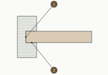
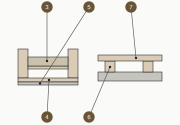

# Dæk, gulv og loft

Kig under gulvbrædderne. Det, der ses fra rummet nedenunder, er kun den yderste del af etagedækket.

[Klikbart tegneark (PDF)](ark.pdf?raw=true) · [Offline browserark](ark.html?raw=true) · [SolidCraft-model](model.sc) · [Tegneopskrift](model.json) · [Hele fagordbogen](../OVERSIGT.md)

Principsnit og opstalter uden mål. Numrene følger delene på tegningen.

## Bjælkeende i murlomme · længdesnit

### Bjælkeende

**[Punkt 1 på tegningen](snit-1.svg).** Enden af den vandrette bjælke går her ind i en lomme i muren. På en besigtigelse kan den være skjult bag puds. [Søren Koch · Fagudtryk fra det traditionelle byggeri · PDF-s. 7](https://danskbyggeskik.dk/publikationer/ordbog_fagudtryk_fra_det_traditionelle_byggeri.pdf#page=7)

### Vederlag

**[Punkt 2 på tegningen](snit-1.svg).** Den del af understøtningen, som bjælken hviler på. Følg kontaktfladen under bjælkeenden. [Søren Koch · Fagudtryk fra det traditionelle byggeri · PDF-s. 54](https://danskbyggeskik.dk/publikationer/ordbog_fagudtryk_fra_det_traditionelle_byggeri.pdf#page=54)

## Tværsnit mellem bjælker og et separat gulv på strøer

### Indskud

**[Punkt 3 på tegningen](snit-2.svg).** Fyldet mellem bjælkerne ligger her på indskudsbrædder. I ældre dæk kan det være ler. [Søren Koch · Fagudtryk fra det traditionelle byggeri · PDF-s. 23](https://danskbyggeskik.dk/publikationer/ordbog_fagudtryk_fra_det_traditionelle_byggeri.pdf#page=23)

### Forskalling

**[Punkt 4 på tegningen](snit-2.svg).** Brædder på undersiden af bjælkerne danner underlag for loftets opbygning. [Søren Koch · Fagudtryk fra det traditionelle byggeri · PDF-s. 31](https://danskbyggeskik.dk/publikationer/ordbog_fagudtryk_fra_det_traditionelle_byggeri.pdf#page=31)

### Puds

**[Punkt 5 på tegningen](snit-2.svg).** Mørtellaget danner den synlige loftsflade. Tegningen viser lagets placering. [Søren Koch · Fagudtryk fra det traditionelle byggeri · PDF-s. 37](https://danskbyggeskik.dk/publikationer/ordbog_fagudtryk_fra_det_traditionelle_byggeri.pdf#page=37)

### Strø

**[Punkt 6 på tegningen](snit-2.svg).** Et stykke træ, der understøtter gulvbrædderne over et underlag. Se det lille gulvsnit til højre. [Søren Koch · Fagudtryk fra det traditionelle byggeri · PDF-s. 48](https://danskbyggeskik.dk/publikationer/ordbog_fagudtryk_fra_det_traditionelle_byggeri.pdf#page=48)

### Gulvbræt

**[Punkt 7 på tegningen](snit-2.svg).** Det øverste bræt, man går på. I højre snit ligger brættet hen over begge strøer. [Søren Koch · Fagudtryk fra det traditionelle byggeri · PDF-s. 7](https://danskbyggeskik.dk/publikationer/ordbog_fagudtryk_fra_det_traditionelle_byggeri.pdf#page=7)
