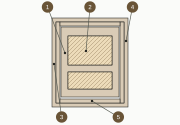
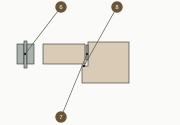

# Døren

Se på fyldingsdøren fra rummet. Følg derefter mødet med karmen i et vandret snit ved låsen.

[Klikbart tegneark (PDF)](ark.pdf?raw=true) · [Offline browserark](ark.html?raw=true) · [SolidCraft-model](model.sc) · [Tegneopskrift](model.json) · [Hele fagordbogen](../OVERSIGT.md)

Principsnit og opstalter uden mål. Numrene følger delene på tegningen.

## Opstalt · blad, fyldinger og indfatning

### Dørblad

**[Punkt 1 på tegningen](snit-1.svg).** Den bevægelige del af døren. På en fyldingsdør hører både det omgivende rammetræ og felterne i midten med til bladet. [Søren Koch · Fagudtryk fra det traditionelle byggeri · PDF-s. 10](https://danskbyggeskik.dk/publikationer/ordbog_fagudtryk_fra_det_traditionelle_byggeri.pdf#page=10)

### Fylding

**[Punkt 2 på tegningen](snit-1.svg).** Pladen i feltet mellem dørbladets rammestykker. Her har døren en stor og en lille fylding. [Søren Koch · Fagudtryk fra det traditionelle byggeri · PDF-s. 17](https://danskbyggeskik.dk/publikationer/ordbog_fagudtryk_fra_det_traditionelle_byggeri.pdf#page=17)

### Gerigt

**[Punkt 3 på tegningen](snit-1.svg).** Listen omkring døråbningen skjuler overgangen mellem karm og væg. Gerigt og indfatning betegner her samme del. [Søren Koch · Fagudtryk fra det traditionelle byggeri · PDF-s. 19](https://danskbyggeskik.dk/publikationer/ordbog_fagudtryk_fra_det_traditionelle_byggeri.pdf#page=19)

### Indfatning

**[Punkt 4 på tegningen](snit-1.svg).** Omramningen på vægfladen langs karmens sider og overkant. Kig efter fugen mellem liste og væg. [Søren Koch · Fagudtryk fra det traditionelle byggeri · PDF-s. 23](https://danskbyggeskik.dk/publikationer/ordbog_fagudtryk_fra_det_traditionelle_byggeri.pdf#page=23)

### Bundstykke

**[Punkt 5 på tegningen](snit-1.svg).** Det nederste stykke af karmen, som man træder over. Bladets nederste træstykke bevæger sig med døren. [Søren Koch · Fagudtryk fra det traditionelle byggeri · PDF-s. 9](https://danskbyggeskik.dk/publikationer/ordbog_fagudtryk_fra_det_traditionelle_byggeri.pdf#page=9)

## Vandret karmprofil ved låsen og løst hængsel i opstalt

### Hængsel

**[Punkt 6 på tegningen](snit-2.svg).** De to beslagblade drejer om en fælles stift. Det ene blad fastgøres til karmen, det andet til døren. Beslaget er vist løst til venstre. [Søren Koch · Fagudtryk fra det traditionelle byggeri · PDF-s. 21](https://danskbyggeskik.dk/publikationer/ordbog_fagudtryk_fra_det_traditionelle_byggeri.pdf#page=21)

### Slutblik

**[Punkt 7 på tegningen](snit-2.svg).** Metalpladen i karmen modtager låsens falle eller rigel. På tegningen ses pladen fra kanten. [Søren Koch · Fagudtryk fra det traditionelle byggeri · PDF-s. 44](https://danskbyggeskik.dk/publikationer/ordbog_fagudtryk_fra_det_traditionelle_byggeri.pdf#page=44)

### Anslag

**[Punkt 8 på tegningen](snit-2.svg).** Fladen, som standser dørbladet i lukket stilling. Her udgør et trin i karmens profil anslaget. [Søren Koch · Fagudtryk fra det traditionelle byggeri · PDF-s. 5](https://danskbyggeskik.dk/publikationer/ordbog_fagudtryk_fra_det_traditionelle_byggeri.pdf#page=5)
