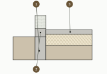
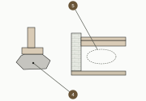
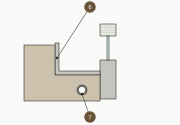

# Sokkel, terræn og kælder

Find først terrænlinjen. Den hjælper med at skelne den synlige sokkel fra fundamentet nedenunder og med at forstå de to forskellige gulvkonstruktioner.

[Klikbart tegneark (PDF)](ark.pdf?raw=true) · [Offline browserark](ark.html?raw=true) · [SolidCraft-model](model.sc) · [Tegneopskrift](model.json) · [Hele fagordbogen](../OVERSIGT.md)

Principsnit og opstalter uden mål. Numrene følger delene på tegningen.

## Fundament og terrændæk · ude til venstre

### Fundament

**[Punkt 1 på tegningen](snit-1.svg).** Den del af underbygningen, der fører husets last til jorden. Det står her under ydermuren. [Videncenter for Energibesparelser · Klimaskærm · PDF-s. 125](https://byggeriogenergi.dk/sites/default/files/download/2024-01/Katalog_klimask%C3%A6rm.pdf#page=125)

### Sokkel

**[Punkt 2 på tegningen](snit-1.svg).** Den synlige fod af huset ved terræn. Følg overgangen mellem jorden og facaden. [Videncenter for Energibesparelser · Klimaskærm · PDF-s. 143](https://byggeriogenergi.dk/sites/default/files/download/2024-01/Katalog_klimask%C3%A6rm.pdf#page=143)

### Terrændæk

**[Punkt 3 på tegningen](snit-1.svg).** Gulvkonstruktionen ligger på opbyggede lag mod jorden. Her ses betonplade, isolering og underlag. [Videncenter for Energibesparelser · Klimaskærm · PDF-s. 125](https://byggeriogenergi.dk/sites/default/files/download/2024-01/Katalog_klimask%C3%A6rm.pdf#page=125)

## To ældre løsninger · syldsten og krybekælder

### Syldsten

**[Punkt 4 på tegningen](snit-2.svg).** En stor sten under bygningen. Her hviler træets fodrem på en marksten i en historisk sokkel. [Slots- og Kulturstyrelsen · Bindingsværk · PDF-s. 5](https://slks.dk/fileadmin/user_upload/SLKS/Omraader/Kulturarv/Bygningsfredning/Faglige_retningslinjer/3_Facader_og_ydervaegge/3.2_Bindingsvaerk.pdf#page=5)

### Krybekælder

**[Punkt 5 på tegningen](snit-2.svg).** Det lave hulrum mellem jord og et løftet gulv. I højre snit kan man følge luften under gulvbjælken. [Videncenter for Energibesparelser · Klimaskærm · PDF-s. 124](https://byggeriogenergi.dk/sites/default/files/download/2024-01/Katalog_klimask%C3%A6rm.pdf#page=124)

## Lyskasse og omfangsdræn · snit langs kældervæggen

### Lyskasse

**[Punkt 6 på tegningen](snit-3.svg).** En forsænket åbning foran et kældervindue giver plads til dagslys neden for terræn. Kassen ses her i snit. [Videncenter for Energibesparelser · Klimaskærm · PDF-s. 143](https://byggeriogenergi.dk/sites/default/files/download/2024-01/Katalog_klimask%C3%A6rm.pdf#page=143)

### Omfangsdræn

**[Punkt 7 på tegningen](snit-3.svg).** Et drænrør langs bygningens yderside opsamler vand i jorden. Her ses røret i tværsnit. Dybde og afledning fastlægges for det konkrete hus. [Videncenter for Energibesparelser · Klimaskærm · PDF-s. 145](https://byggeriogenergi.dk/sites/default/files/download/2024-01/Katalog_klimask%C3%A6rm.pdf#page=145)
