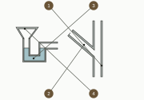
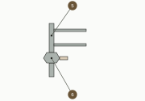
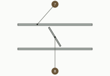

# Vand, varme og ventilation

Tre særskilte systemer er vist i principsnit. Følg først spildevandet, derefter rørene med varmevand og til sidst luftens vej.

[Klikbart tegneark (PDF)](ark.pdf?raw=true) · [Offline browserark](ark.html?raw=true) · [SolidCraft-model](model.sc) · [Tegneopskrift](model.json) · [Hele fagordbogen](../OVERSIGT.md)

Principsnit og opstalter uden mål. Numrene følger delene på tegningen.

## Spildevand · gulvafløb med vandlås og lodret faldstamme

### Faldstamme

**[Punkt 1 på tegningen](snit-1.svg).** Det lodrette afløbsrør fører spildevand ned gennem bygningen. Højre tegning viser en sidetilslutning. [BYG-ERFA · Faldstamme](https://byg-erfa.dk/ordbog/faldstamme)

### Grenrør

**[Punkt 2 på tegningen](snit-1.svg).** Et formstykke forbinder en sideledning med hovedledningen. Her kommer grenen skråt ind fra venstre. [Wavin · Produktkatalog VA · PDF-s. 16](https://mediahub.wavin.com/m/56c361f92647ca86/original/Produktkatalog-VA-2025-high-res.pdf#page=16)

### Vandlås

**[Punkt 3 på tegningen](snit-1.svg).** Vand bliver stående i bøjningen og spærrer for luft fra afløbet. Den farvede del viser vandet efter afløb. [Wavin · Produktkatalog VA · PDF-s. 22](https://mediahub.wavin.com/m/56c361f92647ca86/original/Produktkatalog-VA-2025-high-res.pdf#page=22)

### Gulvafløb

**[Punkt 4 på tegningen](snit-1.svg).** Åbningen i gulvet leder vand ned til afløbssystemet. Tragten er vist i venstre snit; vandlåsen ligger under den. [Wavin · Produktkatalog VA · PDF-s. 22](https://mediahub.wavin.com/m/56c361f92647ca86/original/Produktkatalog-VA-2025-high-res.pdf#page=22)

## Varmeanlæg · en streng med indregulering

### Stigstreng

**[Punkt 5 på tegningen](snit-2.svg).** Det lodrette varmerør forsyner grene på flere etager. I et tostrenget anlæg findes også en returløbsside. [Danfoss · ASV-I · PDF-s. 4](https://assets.danfoss.com/documents/latest/189213/AQ14678647944001-010601.pdf#page=4)

### Strengregulering

**[Punkt 6 på tegningen](snit-2.svg).** Vandmængde eller differenstryk reguleres for en streng, så varmen kan fordeles som planlagt. Punktet viser ventilen ved strengen. [Danfoss · ASV-I · PDF-s. 4](https://assets.danfoss.com/documents/latest/189213/AQ14678647944001-010601.pdf#page=4)

## Ventilation · spjæld i kanal, vist på langs

### Kanal

**[Punkt 7 på tegningen](snit-3.svg).** Den afgrænsede passage fører ventilationsluft. Snittet viser kanalens vægge med den frie passage imellem. [Lindab · DTBVU · PDF-s. 1](https://www.lindab.dk/globalassets/commerce/lindabwebproductsdoc/assets/production/nja1ntniywqtnzazms00ngrllwe5zmutzdbhnzdmzgqxmzqy/5250627243005185442/dtbvu.pdf#page=1)

### Spjæld

**[Punkt 8 på tegningen](snit-3.svg).** Et bevægeligt blad kan ændre luftens frie passage. Her står bladet i en delvis åben stilling. [Lindab · DTBVU · PDF-s. 1](https://www.lindab.dk/globalassets/commerce/lindabwebproductsdoc/assets/production/nja1ntniywqtnzazms00ngrllwe5zmutzdbhnzdmzgqxmzqy/5250627243005185442/dtbvu.pdf#page=1)
