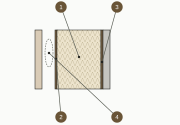
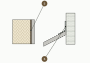

# Klimaskærmens lag

Læs et let vægsnit fra den kolde yderside til den varme inderside. Membranernes tykkelser er overdrevet, så de kan ses.

[Klikbart tegneark (PDF)](ark.pdf?raw=true) · [Offline browserark](ark.html?raw=true) · [SolidCraft-model](model.sc) · [Tegneopskrift](model.json) · [Hele fagordbogen](../OVERSIGT.md)

Principsnit og opstalter uden mål. Numrene følger delene på tegningen.

## Ventileret facade · ude til venstre

### Isolering

**[Punkt 1 på tegningen](snit-1.svg).** Materialet bremser varmestrømmen gennem væggen. Det fylder her feltet mellem den udvendige vindspærre og den indvendige membran. [Videncenter for Energibesparelser · Klimaskærm · PDF-s. 92](https://byggeriogenergi.dk/sites/default/files/download/2024-01/Katalog_klimask%C3%A6rm.pdf#page=92)

### Vindspærre

**[Punkt 2 på tegningen](snit-1.svg).** Laget på isoleringens yderside hindrer, at vind blæser ind i isoleringen. [Videncenter for Energibesparelser · Klimaskærm · PDF-s. 92](https://byggeriogenergi.dk/sites/default/files/download/2024-01/Katalog_klimask%C3%A6rm.pdf#page=92)

### Dampspærre

**[Punkt 3 på tegningen](snit-1.svg).** Det diffusionstætte lag begrænser vanddampens transport ind i konstruktionen. Samlingerne indgår også i husets lufttætte lag. [Videncenter for Energibesparelser · Dampspærreguiden](https://byggeriogenergi.dk/materialer/dampspaerreguiden)

### Ventilationsspalte

**[Punkt 4 på tegningen](snit-1.svg).** Det åbne mellemrum bag beklædningen giver plads til luftbevægelse. Åbninger og sammenhæng i spalten afgør, om den kan ventilere. [Videncenter for Energibesparelser · Klimaskærm · PDF-s. 92](https://byggeriogenergi.dk/sites/default/files/download/2024-01/Katalog_klimask%C3%A6rm.pdf#page=92)

## Alternativ membran og et tag mod mur

### Dampbremse

**[Punkt 5 på tegningen](snit-2.svg).** En membran med lavere modstand mod vanddamp end en traditionel dampspærre. I venstre princip erstatter den dampspærren; valget afhænger af væggens fugtforhold. [Videncenter for Energibesparelser · Dampspærreguiden](https://byggeriogenergi.dk/materialer/dampspaerreguiden)

### Inddækning

**[Punkt 6 på tegningen](snit-2.svg).** Et formet stykke materiale leder regn uden om overgangen mellem to bygningsdele. Til højre er det bukket fra væggen ud over tagfladen. [BYG-ERFA · Metalinddækning mellem tag og mur, åbent uddrag](https://byg-erfa.dk/indaekninger-metal)
