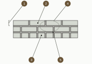
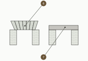
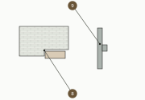

# Facade og murværk

Stå først foran facaden, og se derefter op i en åbning. Den synlige stenside og den bagvedliggende understøtning fortæller forskellige ting.

[Klikbart tegneark (PDF)](ark.pdf?raw=true) · [Offline browserark](ark.html?raw=true) · [SolidCraft-model](model.sc) · [Tegneopskrift](model.json) · [Hele fagordbogen](../OVERSIGT.md)

Principsnit og opstalter uden mål. Numrene følger delene på tegningen.

## Tre skifter i facadeopstalt

### Skifte

**[Punkt 1 på tegningen](snit-1.svg).** Én vandret række mursten. Følg rækken langs facaden. [Søren Koch · Fagudtryk fra det traditionelle byggeri · PDF-s. 41](https://danskbyggeskik.dk/publikationer/ordbog_fagudtryk_fra_det_traditionelle_byggeri.pdf#page=41)

### Løber

**[Punkt 2 på tegningen](snit-1.svg).** Stenen vender langsiden frem. Sammenlign dens længde med den korte ende i nederste række. [Søren Koch · Fagudtryk fra det traditionelle byggeri · PDF-s. 31](https://danskbyggeskik.dk/publikationer/ordbog_fagudtryk_fra_det_traditionelle_byggeri.pdf#page=31)

### Kop

**[Punkt 3 på tegningen](snit-1.svg).** Stenens korte ende ses i facaden. Her er den nederste række tegnet med kopper. [Søren Koch · Fagudtryk fra det traditionelle byggeri · PDF-s. 28](https://danskbyggeskik.dk/publikationer/ordbog_fagudtryk_fra_det_traditionelle_byggeri.pdf#page=28)

### Forbandt

**[Punkt 4 på tegningen](snit-1.svg).** Mønstret opstår, når stenene placeres i forhold til hinanden fra række til række. Se, hvordan de lodrette fuger forskydes. [Søren Koch · Fagudtryk fra det traditionelle byggeri · PDF-s. 14](https://danskbyggeskik.dk/publikationer/ordbog_fagudtryk_fra_det_traditionelle_byggeri.pdf#page=14)

### Fuge

**[Punkt 5 på tegningen](snit-1.svg).** Mellemrummet mellem to sten, her fyldt med mørtel. Vandrette lejefuger og lodrette studsfuger kan ses i samme udsnit. [Søren Koch · Fagudtryk fra det traditionelle byggeri · PDF-s. 17](https://danskbyggeskik.dk/publikationer/ordbog_fagudtryk_fra_det_traditionelle_byggeri.pdf#page=17)

## Over åbningen · muret stik og bjælke som to alternativer

### Stik

**[Punkt 6 på tegningen](snit-2.svg).** Murværk med sten og fuger rettet ind over en åbning. Her er undersiden lige, mens fugerne får retning ud til siderne. [Søren Koch · Fagudtryk fra det traditionelle byggeri · PDF-s. 46](https://danskbyggeskik.dk/publikationer/ordbog_fagudtryk_fra_det_traditionelle_byggeri.pdf#page=46)

### Overligger

**[Punkt 7 på tegningen](snit-2.svg).** En bjælke spænder over åbningen og hviler på murværket ved enderne. Højre åbning viser princippet. [BYG-ERFA · Teglbjælker over åbninger](https://byg-erfa.dk/teglbjaelker-murvaerk-over-vindues-og-doeraabninger)

## Snit i vindueshoved og anker i facadeopstalt

### Overfals

**[Punkt 8 på tegningen](snit-3.svg).** Falsen ved åbningens overkant. Her danner murens spring en kant foran vinduets overkarm. [TEGL 27 · Skalmure, åbningers form og teknik · PDF-s. 24](https://www.mur-tag.dk/fileadmin/user_upload/Editor/pdf/pjecer/TEGL27_Skalmure-aabningers-form-og-teknik.pdf#page=24)

### Muranker

**[Punkt 9 på tegningen](snit-3.svg).** En jernforbindelse holder mur og bjælkelag sammen. Her ses forskudsjernet på murens yderside; selve forbindelsen fortsætter ind i huset. [Søren Koch · Fagudtryk fra det traditionelle byggeri · PDF-s. 33](https://danskbyggeskik.dk/publikationer/ordbog_fagudtryk_fra_det_traditionelle_byggeri.pdf#page=33)
