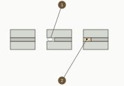
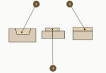
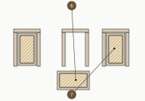

# Spor, reparation og genbrug

Læs fra venstre mod højre. Det nye træ eller den nye mørtel har en lys okkerfarve. Hvert udsnit viser en bestemt handling eller tilstand.

[Klikbart tegneark (PDF)](ark.pdf?raw=true) · [Offline browserark](ark.html?raw=true) · [SolidCraft-model](model.sc) · [Tegneopskrift](model.json) · [Hele fagordbogen](../OVERSIGT.md)

Principsnit og opstalter uden mål. Numrene følger delene på tegningen.

## Mørtelfuge · før udtagning, udkradset og omfuget

### Udkradsning

**[Punkt 1 på tegningen](snit-1.svg).** Den gamle mørtel er taget ud fra facadesiden, her til venstre i hvert snit. I det midterste snit ses den åbne fuge foran den tilbageværende mørtel. [Slots- og Kulturstyrelsen · Murværk · PDF-s. 5](https://slks.dk/fileadmin/user_upload/SLKS/Omraader/Kulturarv/Bygningsfredning/Faglige_retningslinjer/3_Facader_og_ydervaegge/3.1_Murvaerk.pdf#page=5)

### Omfugning

**[Punkt 2 på tegningen](snit-1.svg).** Den yderste del af fugen fornyes. Til højre er den udkradsede plads fyldt med ny mørtel mellem de samme sten. [Slots- og Kulturstyrelsen · Murværk · PDF-s. 5](https://slks.dk/fileadmin/user_upload/SLKS/Omraader/Kulturarv/Bygningsfredning/Faglige_retningslinjer/3_Facader_og_ydervaegge/3.1_Murvaerk.pdf#page=5)

## Reparationer i træ · indfældning, samling og forøgelse

### Udlusning

**[Punkt 3 på tegningen](snit-2.svg).** Et lille beskadiget parti er skåret væk. En tilpasset lus udfylder udskæringen, mens resten af emnet bevares. [Center for Bygningsbevaring · Nænsom istandsættelse af vinduer · PDF-s. 2](https://www.bygningsbevaring.dk/uploads/files/anvisninger/10-ANVISN_Naensom_istands_vinduer.pdf#page=2)

### Lask

**[Punkt 4 på tegningen](snit-2.svg).** Et særskilt stykke overlapper forbindelsen mellem to træender. Her ses lasken langs samlingen; fastgørelserne er udeladt. [Søren Koch · Fagudtryk fra det traditionelle byggeri · PDF-s. 30](https://danskbyggeskik.dk/publikationer/ordbog_fagudtryk_fra_det_traditionelle_byggeri.pdf#page=30)

### Påforing

**[Punkt 5 på tegningen](snit-2.svg).** Et ekstra stykke tilføjes langs et eksisterende emne for at øge dets dimension. Her bliver det oprindelige spær højere. [Videncenter for Energibesparelser · Dampspærreguiden](https://byggeriogenergi.dk/materialer/dampspaerreguiden)

## Samme dørblad · på plads, taget af, på plads igen

### Demontering

**[Punkt 6 på tegningen](snit-3.svg).** Bygningsdelen frigøres som en enhed. I midterfeltet står karmen tom, og dørbladet er lagt ved siden af. Registrér del, beslag og oprindelig placering. [Dialogværktøj · Genbrugte indvendige døre · PDF-s. 74](https://www.ucviden.dk/ws/files/107139883/Dialogv_rkt_j_samlet_20190917.pdf#page=74)

### Genmontering

**[Punkt 7 på tegningen](snit-3.svg).** Den bevarede del sættes på plads igen. Til højre sidder det samme fyldingsblad i karmen. På en byggesag skal pasning og funktion prøves efter monteringen. [Dialogværktøj · Genbrugte indvendige døre · PDF-s. 74](https://www.ucviden.dk/ws/files/107139883/Dialogv_rkt_j_samlet_20190917.pdf#page=74)
