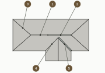
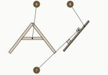
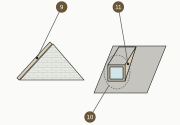

# Resten af taget

Følg vandets vej på en tagplan. Se derefter et spærfag i snit og en kvist set fra siden.

[Klikbart tegneark (PDF)](ark.pdf?raw=true) · [Offline browserark](ark.html?raw=true) · [SolidCraft-model](model.sc) · [Tegneopskrift](model.json) · [Hele fagordbogen](../OVERSIGT.md)

Principsnit og opstalter uden mål. Numrene følger delene på tegningen.

## Tagplan · valmet hovedtag med en tværfløj

### Kip

**[Punkt 1 på tegningen](snit-1.svg).** Den øverste linje, hvor de to store tagflader mødes. I et lodret snit ses kippen som tagets øverste punkt. [Søren Koch · Fagudtryk fra det traditionelle byggeri · PDF-s. 26](https://danskbyggeskik.dk/publikationer/ordbog_fagudtryk_fra_det_traditionelle_byggeri.pdf#page=26)

### Rygning

**[Punkt 2 på tegningen](snit-1.svg).** Afslutningen over samlingen i kippen. På tegltage kan den bestå af særlige rygningssten. Her peger nummeret på dens forløb. [Jeanne Brüel · Taget · PDF-s. 26](https://gi.dk/media/adcp1scx/kompendium-med-temaet-tag.pdf#page=26)

### Grat

**[Punkt 3 på tegningen](snit-1.svg).** Tagflader mødes i et udadgående hjørne. Regn på de tilstødende flader løber væk fra graten. [Søren Koch · Fagudtryk fra det traditionelle byggeri · PDF-s. 20](https://danskbyggeskik.dk/publikationer/ordbog_fagudtryk_fra_det_traditionelle_byggeri.pdf#page=20)

### Kel

**[Punkt 4 på tegningen](snit-1.svg).** Det indadgående hjørne, hvor tværfløj og hovedtag mødes. Her løber vand fra begge tagflader sammen. [Søren Koch · Fagudtryk fra det traditionelle byggeri · PDF-s. 25](https://danskbyggeskik.dk/publikationer/ordbog_fagudtryk_fra_det_traditionelle_byggeri.pdf#page=25)

### Skotrende

**[Punkt 5 på tegningen](snit-1.svg).** Renden langs en kel leder det samlede vand ned. Nummeret viser rendens placering i tagplanen. [Søren Koch · Fagudtryk fra det traditionelle byggeri · PDF-s. 43](https://danskbyggeskik.dk/publikationer/ordbog_fagudtryk_fra_det_traditionelle_byggeri.pdf#page=43)

## Tagværk · tværsnit og lag langs en tagflade

### Hanebånd

**[Punkt 6 på tegningen](snit-2.svg).** Det vandrette træstykke forbinder de to spær et stykke under kippen. [Søren Koch · Fagudtryk fra det traditionelle byggeri · PDF-s. 21](https://danskbyggeskik.dk/publikationer/ordbog_fagudtryk_fra_det_traditionelle_byggeri.pdf#page=21)

### Lægte

**[Punkt 7 på tegningen](snit-2.svg).** Et smalt træstykke på tværs af spærene bærer tagdækningen. I detaljen til højre er to lægter skåret over. [Søren Koch · Fagudtryk fra det traditionelle byggeri · PDF-s. 31](https://danskbyggeskik.dk/publikationer/ordbog_fagudtryk_fra_det_traditionelle_byggeri.pdf#page=31)

### Undertag

**[Punkt 8 på tegningen](snit-2.svg).** Laget under den ydre tagdækning opfanger vand, der kommer forbi dækningen. Her er det vist under afstandslisten. [Jeanne Brüel · Taget · PDF-s. 15](https://gi.dk/media/adcp1scx/kompendium-med-temaet-tag.pdf#page=15)

## Gavlkant og kvist · to udsnit af tagets yderside

### Vindskede

**[Punkt 9 på tegningen](snit-3.svg).** Brættet følger gavlens skrå tagkant. Se efter det langs kanten set fra gavlen. [Søren Koch · Fagudtryk fra det traditionelle byggeri · PDF-s. 55](https://danskbyggeskik.dk/publikationer/ordbog_fagudtryk_fra_det_traditionelle_byggeri.pdf#page=55)

### Kvist

**[Punkt 10 på tegningen](snit-3.svg).** En lille udbygning gennem den skrå tagflade med egen front og tag. Her ses kvistvinduet forfra og siden skråt. [Søren Koch · Fagudtryk fra det traditionelle byggeri · PDF-s. 50](https://danskbyggeskik.dk/publikationer/ordbog_fagudtryk_fra_det_traditionelle_byggeri.pdf#page=50)

### Flunk

**[Punkt 11 på tegningen](snit-3.svg).** Kvistens side mellem fronten og hovedtaget. Der er en flunk på hver side. [Søren Koch · Fagudtryk fra det traditionelle byggeri · PDF-s. 14](https://danskbyggeskik.dk/publikationer/ordbog_fagudtryk_fra_det_traditionelle_byggeri.pdf#page=14)
