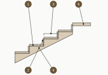
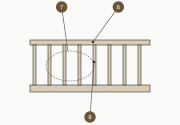

# Trappe og adgang

Se trappen fra siden. En vandret afstand, en skrå bærende del og en håndliste kan følges hver for sig.

[Klikbart tegneark (PDF)](ark.pdf?raw=true) · [Offline browserark](ark.html?raw=true) · [SolidCraft-model](model.sc) · [Tegneopskrift](model.json) · [Hele fagordbogen](../OVERSIGT.md)

Principsnit og opstalter uden mål. Numrene følger delene på tegningen.

## Trappeløb i sidebillede

### Trin

**[Punkt 1 på tegningen](snit-1.svg).** Den vandrette del, som foden sættes på. På denne lukkede trappe ses et lodret bræt mellem trinene. [Søren Koch · Fagudtryk fra det traditionelle byggeri · PDF-s. 51](https://danskbyggeskik.dk/publikationer/ordbog_fagudtryk_fra_det_traditionelle_byggeri.pdf#page=51)

### Stødtrin

**[Punkt 2 på tegningen](snit-1.svg).** Den lodrette flade mellem to trin. På en åben trappe kan man se gennem mellemrummet. [Søren Koch · Fagudtryk fra det traditionelle byggeri · PDF-s. 48](https://danskbyggeskik.dk/publikationer/ordbog_fagudtryk_fra_det_traditionelle_byggeri.pdf#page=48)

### Grund

**[Punkt 3 på tegningen](snit-1.svg).** Det vandrette mål fra én trinforkant til den næste langs ganglinjen. Punktet ligger på dette vandrette stykke i sidebilledet. [BV Trappen · Grund og stigning · PDF-s. 1](https://bv-trappen.dk/media/2419/grund-og-stigning.pdf#page=1)

### Vange

**[Punkt 4 på tegningen](snit-1.svg).** Det skrå sidestykke bærer trinene langs trappeløbet. Her ligger dets nederste kant under trinrækken. [Søren Koch · Fagudtryk fra det traditionelle byggeri · PDF-s. 51](https://danskbyggeskik.dk/publikationer/ordbog_fagudtryk_fra_det_traditionelle_byggeri.pdf#page=51)

### Repos

**[Punkt 5 på tegningen](snit-1.svg).** Den vandrette platform ved et trappeløb giver plads til at standse, gå ind på en etage eller skifte retning. [Søren Koch · Fagudtryk fra det traditionelle byggeri · PDF-s. 39](https://danskbyggeskik.dk/publikationer/ordbog_fagudtryk_fra_det_traditionelle_byggeri.pdf#page=39)

## Værnet langs en repos

### Håndliste

**[Punkt 6 på tegningen](snit-2.svg).** Den øverste liste er formet, så man kan gribe om den. Den følger her reposens vandrette kant. [Søren Koch · Fagudtryk fra det traditionelle byggeri · PDF-s. 22](https://danskbyggeskik.dk/publikationer/ordbog_fagudtryk_fra_det_traditionelle_byggeri.pdf#page=22)

### Værn

**[Punkt 7 på tegningen](snit-2.svg).** Hele afskærmningen langs den åbne side beskytter mod fald. Den omfatter her de lodrette stave og håndlisten. [Bygningsreglementet · Værn og håndlister](https://www.bygningsreglementet.dk/tekniske-bestemmelser/02/krav/58_60/)

### Baluster

**[Punkt 8 på tegningen](snit-2.svg).** En af de enkelte stave i værnet. Den står her mellem repos og håndliste. [Søren Koch · Fagudtryk fra det traditionelle byggeri · PDF-s. 6](https://danskbyggeskik.dk/publikationer/ordbog_fagudtryk_fra_det_traditionelle_byggeri.pdf#page=6)
