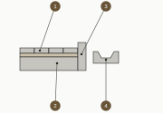
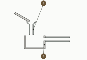

# Uderum og afvanding

Begynd ved terrassens kant, og følg vandet fra overfladen til renden. Se derefter, hvordan regnvand fra taget kan nå en brønd.

[Klikbart tegneark (PDF)](ark.pdf?raw=true) · [Offline browserark](ark.html?raw=true) · [SolidCraft-model](model.sc) · [Tegneopskrift](model.json) · [Hele fagordbogen](../OVERSIGT.md)

Principsnit og opstalter uden mål. Numrene følger delene på tegningen.

## Tværsnit · belægning, kant og åben rende

### Belægning

**[Punkt 1 på tegningen](snit-1.svg).** Det slidlag, man går eller kører på. Her består det af enkeltsten med fuger imellem. [IBF · Belægningssten](https://www.ibf.dk/privat/Inspiration/Belaegning/Guides/Saadan-laegger-du-fliser-og-belaegningssten/)

### Bærelag

**[Punkt 2 på tegningen](snit-1.svg).** Laget fordeler belastningen under belægningen. Et tyndere afretningslag ligger mellem bærelag og sten. [IBF · Belægningssten](https://www.ibf.dk/privat/Inspiration/Belaegning/Guides/Saadan-laegger-du-fliser-og-belaegningssten/)

### Kantsten

**[Punkt 3 på tegningen](snit-1.svg).** Stenen langs kanten afgrænser og støtter belægningen. I snittet er den højere end belægningsstenene. [IBF · Belægningssten](https://www.ibf.dk/privat/Inspiration/Belaegning/Guides/Saadan-laegger-du-fliser-og-belaegningssten/)

### Rende

**[Punkt 4 på tegningen](snit-1.svg).** En aflang fordybning samler og fører overfladevand. Til højre ses den på tværs af vandets vej. [IBF · Åbne vandrender](https://www.ibf.dk/professionel/Baeredygtighed/Et-mere-baeredygtigt-byggeri/Produkter/LAR-loesninger-Lokal-haandtering-af-regnvand/Linjeafvanding-og-vandrender/)

## Fra nedløbsrør til brønd · principsnit

### Nedløb

**[Punkt 5 på tegningen](snit-2.svg).** Det lodrette rør fører regnvand fra tagrenden ned til terræn eller en regnvandsledning. Her munder det ud over brønden. [Wavin · Rendestens- og tagnedløbsbrønde](https://wavin.com/dk/da/s/C02_F003_S076/rendestens-og-tagnedlobsbronde/p)

### Brønd

**[Punkt 6 på tegningen](snit-2.svg).** Et tilgængeligt kammer i afløbssystemet. I denne variant sidder udløbet over bunden, så der er plads til bundfældet materiale. [Wavin · Rendestens- og tagnedløbsbrønde](https://wavin.com/dk/da/s/C02_F003_S076/rendestens-og-tagnedlobsbronde/p)
