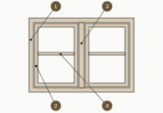
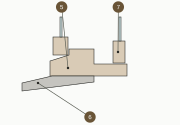
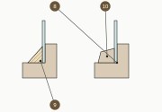

# Vinduet

Hvad følger med, når man åbner vinduet? Begynd med opstalten udefra, og følg derefter rudens nederste kant i tre forskellige snit.

[Klikbart tegneark (PDF)](ark.pdf?raw=true) · [Offline browserark](ark.html?raw=true) · [SolidCraft-model](model.sc) · [Tegneopskrift](model.json) · [Hele fagordbogen](../OVERSIGT.md)

Principsnit og opstalter uden mål. Numrene følger delene på tegningen.

## Opstalt · de faste og oplukkelige dele

### Karm

**[Punkt 1 på tegningen](snit-1.svg).** Karmen er vinduets faste yderste træværk. Den bliver siddende i muråbningen, når rammen åbnes. [Søren Koch · Fagudtryk fra det traditionelle byggeri · PDF-s. 55](https://danskbyggeskik.dk/publikationer/ordbog_fagudtryk_fra_det_traditionelle_byggeri.pdf#page=55)

### Ramme

**[Punkt 2 på tegningen](snit-1.svg).** Den mindre træramme holder ruden. Her sidder én oplukkelig ramme på hver side af posten. [Søren Koch · Fagudtryk fra det traditionelle byggeri · PDF-s. 56](https://danskbyggeskik.dk/publikationer/ordbog_fagudtryk_fra_det_traditionelle_byggeri.pdf#page=56)

### Post

**[Punkt 3 på tegningen](snit-1.svg).** Det lodrette stykke i midten deler karmen i to fag. En vandret post kaldes en tværpost. [GI · Bedre vinduer · PDF-s. 12](https://gi.dk/media/sbhn2dac/bedre-vinduer-2-udgave.pdf#page=12)

### Sprosse

**[Punkt 4 på tegningen](snit-1.svg).** Den smalle liste deler selve rammen i mindre rudefelter. Her deler den hvert fag på tværs. [Søren Koch · Fagudtryk fra det traditionelle byggeri · PDF-s. 45](https://danskbyggeskik.dk/publikationer/ordbog_fagudtryk_fra_det_traditionelle_byggeri.pdf#page=45)

## Bundsnit · ude til venstre, inde til højre

### Bundstykke

**[Punkt 5 på tegningen](snit-2.svg).** Karmens nederste vandrette stykke. I snittet ligger det under den udvendige ramme. Også døren har et bundstykke. [Søren Koch · Fagudtryk fra det traditionelle byggeri · PDF-s. 9](https://danskbyggeskik.dk/publikationer/ordbog_fagudtryk_fra_det_traditionelle_byggeri.pdf#page=9)

### Sålbænk

**[Punkt 6 på tegningen](snit-2.svg).** Den skrå flade under vinduet leder vand ud fra facaden. Den ligger uden for karmen. [Søren Koch · Fagudtryk fra det traditionelle byggeri · PDF-s. 49](https://danskbyggeskik.dk/publikationer/ordbog_fagudtryk_fra_det_traditionelle_byggeri.pdf#page=49)

### Forsatsramme

**[Punkt 7 på tegningen](snit-2.svg).** En ekstra ramme med glas på indersiden. Luftmellemrummet adskiller den fra det oprindelige vindue. [GI · Bedre vinduer · PDF-s. 12](https://gi.dk/media/sbhn2dac/bedre-vinduer-2-udgave.pdf#page=12)

## Rudekanten · kit til venstre og glasliste til højre

### Fals

**[Punkt 8 på tegningen](snit-3.svg).** Et trin i profilet giver plads til en anden del. Her ligger glas og glasliste i den indadgående vinkel. [Søren Koch · Fagudtryk fra det traditionelle byggeri · PDF-s. 12](https://danskbyggeskik.dk/publikationer/ordbog_fagudtryk_fra_det_traditionelle_byggeri.pdf#page=12)

### Kitfals

**[Punkt 9 på tegningen](snit-3.svg).** I venstre profil er falsen beregnet til glas og kit. Den skrå kitflade beskytter rudens kant. [GI · Bedre vinduer · PDF-s. 12](https://gi.dk/media/sbhn2dac/bedre-vinduer-2-udgave.pdf#page=12)

### Glasliste

**[Punkt 10 på tegningen](snit-3.svg).** Den særskilte liste i højre profil fastholder glasset. Den kan ses som en selvstændig del langs rudekanten. [GI · Bedre vinduer · PDF-s. 15](https://gi.dk/media/sbhn2dac/bedre-vinduer-2-udgave.pdf#page=15)
