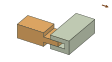
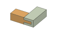

# Halvskjult hjørnetap

Fra den ene side kan et hjørne ligne en slidstap. Vend hjørnet om: en del af træet kan være bevaret foran tapenden.

## Samleretningen

Før tappen ind mellem kinderne. Den standser inde i det modtagende stykke, hvor den almindelige slidstap kunne ses helt ud til kanten.

## Læs snittet

I det vandrette snit ligger der et stykke grønt træ foran den okkerfarvede tapspids. Sammenlign med samme snit i slidstappen.

## Ved en besigtigelse

Registrér begge ydersider af hjørnet. Den side, der ser ubrudt ud, giver en anden oplysning end den flade, hvor man kan se skuldrene.

[Kaare Kristensen · fig. 52 · PDF-s. 29](https://danskbyggeskik.dk/publikationer/487%20-%20t%C3%B8mrerarbejde.pdf#page=29)

[SolidCraft-model](model.sc) · [Modelopskrift](model.json) · [Bogen](../README.md)
