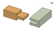

# Halvskjult hjørnetap

Vend hjørnet om. På den ene side ligner det en slidstap. På den anden side løber træet ubrudt hen foran tapenden. Tømreren har ladet en del af kanten blive stående.

Den flade tap går ind mellem kinderne på samme måde som før, men den er kortere. På snittet kan du følge det okkerfarvede træ hen til den grønne strimmel foran spidsen. Der standser det.

Tænk på de to sider som hver sit vidne. Den ene viser dig, hvor delene mødes. Den anden viser, at tappen aldrig nåede helt igennem.

[Kaare Kristensen · fig. 52 · PDF-s. 29](https://danskbyggeskik.dk/publikationer/487%20-%20t%C3%B8mrerarbejde.pdf#page=29)

[SolidCraft-model](model.sc) · [Modelopskrift](model.json) · [Bogen](../README.md)
