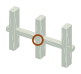
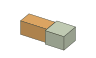

# Tap med bærebryst

Den vandrette bjælke har to fremspring. Det lange kan du straks kende som en tap. Se så efter det lille trin nedenunder. Det er bærebrystet.

Før bjælken ind mod åbningen. Først finder tappen vej ind i hullet. Lige inden skuldrene mødes, går det korte bryst ind i sit eget lave indhug. Nu har træet også fået et særskilt sted at hvile under brystet.

På en opmåling er to små streger vigtige: den ene ved tapspidsen, den anden under brystet. Et mellemrum det første sted og en revne det andet fortæller hver sin historie om samlingen.

[Kaare Kristensen · fig. 41 · PDF-s. 28](https://danskbyggeskik.dk/publikationer/487%20-%20t%C3%B8mrerarbejde.pdf#page=28)

[SolidCraft-model](model.sc) · [Modelopskrift](model.json) · [Bogen](../README.md)
