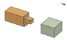
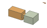
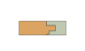

# Tap med bærebryst

Ved en vandret tilslutning kan træet bæres både ved tappen og på et særskilt kort bryst nedenunder.

## Samleretningen

Før bjælkeenden vandret mod åbningen. Først kommer tappen ind; ved den sidste tilnærmelse kommer det korte bryst ind i sit eget lave indhug.

## Læs snittet

Snittet viser to fremspring med forskellig rækkevidde. Skulderens yderflade, brystets anlæg og hullets bund er tre forskellige steder.

## Ved en besigtigelse

Markér kontaktstedet under brystet. En revne her og et mellemrum ved tapspidsen er forskellige iagttagelser og bør beskrives hver for sig.

[Kaare Kristensen · fig. 41 · PDF-s. 28](https://danskbyggeskik.dk/publikationer/487%20-%20t%C3%B8mrerarbejde.pdf#page=28)

[SolidCraft-model](model.sc) · [Modelopskrift](model.json) · [Bogen](../README.md)
