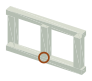
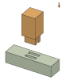

# Dobbelttap

To aflange huller i remmen og kun én stolpe at rejse. Tømreren har delt indgrebet i to ved at lade to tappe stå tilbage på stolpens ende.

Begge skal finde deres hul i samme bevægelse. Sidder den ene ved siden af, bliver skulderen stående over remmen. Når begge er på plads, står der stadig grønt træ mellem de to tappe.

Prøv at finde det mellemstykke i tværsnittet. Det er dét, man mister af syne, hvis man tegner to tappe som ét bredt felt. Studietavlen viser stolpen skåret både på tværs og vandret.

[Kaare Kristensen · fig. 39 · PDF-s. 28](https://danskbyggeskik.dk/publikationer/487%20-%20t%C3%B8mrerarbejde.pdf#page=28)

[SolidCraft-model](model.sc) · [Modelopskrift](model.json) · [Bogen](../README.md)
