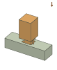
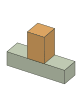
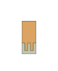

# Dobbelttap

To parallelle tappe kan dele et bredt tømmerendes indgreb op. Der skal både være træ uden om yderkanterne og træ mellem hullerne.

## Samleretningen

Før begge tappe ind samtidigt. Hvis blot én tap rammer ved siden af, kan skulderen ikke nå helt frem til remmen.

## Læs snittet

Tværsnittet går på tværs af de to tappe. Sammenlign træstykket mellem hullerne med de to yderkinder; alle tre kan ses her.

## Ved en besigtigelse

Tegn hullerne som to åbninger. En enkelt bred signatur ville skjule det mellemstykke, som er afgørende for at genkende typen.

[Kaare Kristensen · fig. 39 · PDF-s. 28](https://danskbyggeskik.dk/publikationer/487%20-%20t%C3%B8mrerarbejde.pdf#page=28)

[SolidCraft-model](model.sc) · [Modelopskrift](model.json) · [Bogen](../README.md)
