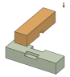
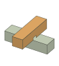

# Dobbeltkam

Her efterlader de to indhug en kam midt på underemnet. Navnet kan forvirre: kig efter træet på begge sider af den tilbageværende ryg.

## Samleretningen

Sænk overemnet, så dets rille griber om kammen. De tilstødende stykker ved siden af rillen lander i de lavere felter.

## Læs snittet

Tværsnittet åbner de to sidefelter samt den ene ryg i midten. Det er svært at se denne opdeling i en lukket samling fra oven.

## Ved en besigtigelse

Sammenhold den sideværts placering med enkeltkam. Hvis kun den ene side er tilgængelig, bør den anden side fremgå som en antagelse på tegningen.

[Kaare Kristensen · fig. 58 · PDF-s. 29](https://danskbyggeskik.dk/publikationer/487%20-%20t%C3%B8mrerarbejde.pdf#page=29) · [G. v. Huth · tegning 131 · PDF-s. 33](https://danskbyggeskik.dk/publikationer/324%20-%20tr%C3%A6forbindelser%20for%20br%C3%A6der,%20planker%20og%20t%C3%B8mmer.%2024%20tavler%20med%20bem%C3%A6rkninger.pdf#page=33)

[SolidCraft-model](model.sc) · [Modelopskrift](model.json) · [Bogen](../README.md)
