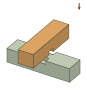
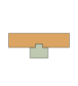

# Dobbeltkam

Navnet kan få en til at lede efter to kamme. Kig i stedet efter de to steder, hvor tømreren har taget træ væk. Mellem dem står én ryg tilbage i midten af underbjælken.

På den øverste bjælkes underside sidder rillen, som passer ned over ryggen. Når delene samles, lukker træet omkring kammen fra begge sider. Fra oven er alt det interessante nu skjult.

Tværsnittet åbner forbindelsen igen. Find ryggen i midten og de to lave felter ved siden af. På Huths tavle kan man følge samme detalje fra flere retninger.

[Kaare Kristensen · fig. 58 · PDF-s. 29](https://danskbyggeskik.dk/publikationer/487%20-%20t%C3%B8mrerarbejde.pdf#page=29) · [G. v. Huth · tegning 131 · PDF-s. 33](https://danskbyggeskik.dk/publikationer/324%20-%20tr%C3%A6forbindelser%20for%20br%C3%A6der,%20planker%20og%20t%C3%B8mmer.%2024%20tavler%20med%20bem%C3%A6rkninger.pdf#page=33)

[SolidCraft-model](model.sc) · [Modelopskrift](model.json) · [Bogen](../README.md)
