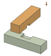
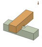
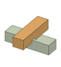
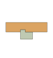

# Enkeltkam

Når to tømmerstykker krydser i forskellige niveauer, kan den tilbageværende kam ligge ved den ene side af det nederste emne.

## Samleretningen

Anbring overemnets tilsvarende udskæring direkte over kammen. Det skal sænkes med den rigtige kant mod kammen; tværprofilet er asymmetrisk.

## Læs snittet

I tværsnittet ligger den høje del af underemnet ved kanten. Ved dobbeltkammen ligger den tilbageværende ryg længere inde.

## Ved en besigtigelse

Notér hvilken side der bærer kammen. En spejlvending kan se overbevisende ud på en løs skitse og alligevel beskrive det forkerte hjørne.

[Kaare Kristensen · fig. 57 · PDF-s. 29](https://danskbyggeskik.dk/publikationer/487%20-%20t%C3%B8mrerarbejde.pdf#page=29)

[SolidCraft-model](model.sc) · [Modelopskrift](model.json) · [Bogen](../README.md)
