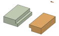
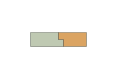

# Fals i fals

Langs en bræddebeklædning kan et åbent trin på den ene kant dække det modsatte trin på nabobrættet.

## Samleretningen

Før det øverste læbestykke ind over den nederste læbe. Her føres brættet sidelæns. De åbne trin gør også geometrien tilgængelig fra fladen inden fastgørelse.

## Læs snittet

På tværs af brædderne får fugen to retningsskift. Ved en not er der træ på begge sider af en fjeder; her dækker de to kanter hinanden.

## Ved en besigtigelse

Registrér beklædningens retning og hvilken bræddekant der ligger yderst. Huth knytter orienteringen til udsættelsen for regn på udvendige flader.

[G. v. Huth · fig. 18 · PDF-s. 6](https://danskbyggeskik.dk/publikationer/324%20-%20tr%C3%A6forbindelser%20for%20br%C3%A6der,%20planker%20og%20t%C3%B8mmer.%2024%20tavler%20med%20bem%C3%A6rkninger.pdf#page=6) · [G. v. Huth · tegning 18 · PDF-s. 17](https://danskbyggeskik.dk/publikationer/324%20-%20tr%C3%A6forbindelser%20for%20br%C3%A6der,%20planker%20og%20t%C3%B8mmer.%2024%20tavler%20med%20bem%C3%A6rkninger.pdf#page=17)

[SolidCraft-model](model.sc) · [Modelopskrift](model.json) · [Bogen](../README.md)
