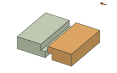
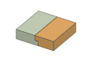

# Fals i fals

Prøv at tegne denne fuge uden at løfte blyanten. Først går du ned langs kanten, så hen over et trin og til sidst ned igen. De to brædder har fået hver sin fals, og den ene læbe dækker den anden.

På den adskilte tegning ligger begge trin åbne. Når brædderne føres sammen, lægger det øvre stykke sig over det nedre. Du kan følge hver kant hele vejen ud til spidsen i tværsnittet.

På en udvendig beklædning får det betydning, hvilken vej den åbne fuge vender mod regnen. G. v. Huth tog den oplysning med sammen med tegningen. Gør det samme på din egen skitse: markér hvilken side af brættet der vendte ud.

[G. v. Huth · fig. 18 · PDF-s. 6](https://danskbyggeskik.dk/publikationer/324%20-%20tr%C3%A6forbindelser%20for%20br%C3%A6der,%20planker%20og%20t%C3%B8mmer.%2024%20tavler%20med%20bem%C3%A6rkninger.pdf#page=6) · [G. v. Huth · tegning 18 · PDF-s. 17](https://danskbyggeskik.dk/publikationer/324%20-%20tr%C3%A6forbindelser%20for%20br%C3%A6der,%20planker%20og%20t%C3%B8mmer.%2024%20tavler%20med%20bem%C3%A6rkninger.pdf#page=17)

[SolidCraft-model](model.sc) · [Modelopskrift](model.json) · [Bogen](../README.md)
