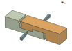
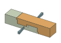
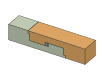
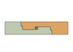

# Fransk lås

Der ligger fire stykker træ på bukkene. To af dem skal blive til én lang bjælke. De to andre er kiler. Du kan holde én i hver hånd. I den franske lås skal alle fire på plads i den rigtige rækkefølge.

Først sænker tømreren de lange blade forbi hinanden med lidt afstand mellem skuldrene. Dernæst skydes bjælken på langs. Nu finder den lille fjeder for enden af hvert blad sin udskæring i det andet. Først da er åbningen midt i samlingen klar. Fra hver sin side kan en kile føres ind, indtil de to skrå kileflader mødes.

Se det færdige arbejde på G. v. Huths tegning 83, og find så de samme dele på studietavlen bag i bogen. Udefra kan kilerne ligne ét firkantet stykke. Snittet viser den skrå fuge imellem dem. Dér ligger forklaringen på, hvordan to kiler kan udfylde ét hul.

[Kaare Kristensen · fig. 25 · PDF-s. 27](https://danskbyggeskik.dk/publikationer/487%20-%20t%C3%B8mrerarbejde.pdf#page=27) · [G. v. Huth · tegning 83 · PDF-s. 24](https://danskbyggeskik.dk/publikationer/324%20-%20tr%C3%A6forbindelser%20for%20br%C3%A6der,%20planker%20og%20t%C3%B8mmer.%2024%20tavler%20med%20bem%C3%A6rkninger.pdf#page=24)

[SolidCraft-model](model.sc) · [Modelopskrift](model.json) · [Bogen](../README.md)
