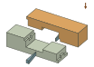

# Fransk lås

En fransk lås forbinder to bjælkeender med et hageblad, styr ved enderne og forkilning i midten. Huths figur 83 viser, at endernes tværprofil også er en del af forbindelsen.

## Samleretningen

Læg bladene over hinanden med lidt afstand på langs. Før de korte fremspring ind i de modsatte skuldre. Før de to kiler fra hver sin side ind i midteråbningen. I principsnittet har kilerne tilsammen rektangulært omrids.

## Læs snittet

I længdesnittet ses hagen og nøglefeltet. På tværs er der en smal fjedertap på endestyret. Det brede fremspring ved enden og den smallere fjeder styrer i forskellige retninger.

## Ved en besigtigelse

Find først samlingens to yderste skuldre. Markér derefter hvor der kræves plads til langsgående forskydning og adgang fra begge sider til kilerne. Sammenlign også originalens projektioner fra oven og fra siden.

[Kaare Kristensen · fig. 25 · PDF-s. 27](https://danskbyggeskik.dk/publikationer/487%20-%20t%C3%B8mrerarbejde.pdf#page=27) · [G. v. Huth · tegning 83 · PDF-s. 24](https://danskbyggeskik.dk/publikationer/324%20-%20tr%C3%A6forbindelser%20for%20br%C3%A6der,%20planker%20og%20t%C3%B8mmer.%2024%20tavler%20med%20bem%C3%A6rkninger.pdf#page=24)

[SolidCraft-model](model.sc) · [Modelopskrift](model.json) · [Bogen](../README.md)
