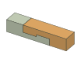

# Lige hageblad

Midt på bladet har tømreren ladet et lille trin stå. Stryg en finger hen ad den flade bjælkeende i tankerne. Det er dér, den ville standse. Trinnets lodrette side bliver en hage.

Overbladet sænkes på plads. Når det ligger i ro, sidder dets tykkere del på den anden side af underbladets trin. Et løft kan åbne træformen igen. Et træk lige ud ad bjælken møder modstand ved hagen.

På gammelt tømmer er det lille trin værd at undersøge tæt på. Er der stadig en kant, der kan møde den anden del, eller er træet slidt bort? Her kan et par centimeter fortælle mere om forbindelsen end hele den synlige bjælkelængde.

[Kaare Kristensen · fig. 21 · PDF-s. 26](https://danskbyggeskik.dk/publikationer/487%20-%20t%C3%B8mrerarbejde.pdf#page=26) · [G. v. Huth · tegning 80 · PDF-s. 24](https://danskbyggeskik.dk/publikationer/324%20-%20tr%C3%A6forbindelser%20for%20br%C3%A6der,%20planker%20og%20t%C3%B8mmer.%2024%20tavler%20med%20bem%C3%A6rkninger.pdf#page=24)

[SolidCraft-model](model.sc) · [Modelopskrift](model.json) · [Bogen](../README.md)
