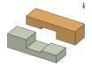
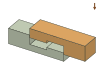
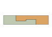

# Lige hageblad

Et lille trin midt på bladet ændrer, hvad der sker, når de to bjælkeender trækkes fra hinanden. Her får hver ende en hage.

## Samleretningen

Sænk overbladet fra oven. Forsøg i tankerne at trække emnerne på langs, mens højden holdes fast: trinnets opstående flade kommer i vejen. Et løft frigør igen træformen.

## Læs snittet

Se fra siden: ved bladets rod er der mindre træ tilbage end ved dets spids. Det er denne forskel, der skaber modholdet.

## Ved en besigtigelse

Registrér om hagen stadig har en tydelig kant. Slid eller tab af træ netop ved trinnet ændrer kontaktforholdene. Kildens øvrige sikringer er udeladt.

[Kaare Kristensen · fig. 21 · PDF-s. 26](https://danskbyggeskik.dk/publikationer/487%20-%20t%C3%B8mrerarbejde.pdf#page=26) · [G. v. Huth · tegning 80 · PDF-s. 24](https://danskbyggeskik.dk/publikationer/324%20-%20tr%C3%A6forbindelser%20for%20br%C3%A6der,%20planker%20og%20t%C3%B8mmer.%2024%20tavler%20med%20bem%C3%A6rkninger.pdf#page=24)

[SolidCraft-model](model.sc) · [Modelopskrift](model.json) · [Bogen](../README.md)
