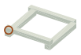
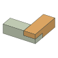

# Lige hjørneblad

Følg en træramme med hånden. Ved hjørnet slipper det ene stykke og det næste tager over i en ny retning. Under hånden ligger enderne et kort stykke oven på hinanden.

Tømreren skærer væk fra oversiden på den ene ende og fra undersiden på den anden. De to halve tykkelser fylder hjørnet ud. På den samlede ramme kan hånden fortsætte rundt på en plan overside.

Det vandrette snit i tegningen er lagt højt. Derfor tilhører træet i selve hjørnet kun overbladet. Lidt længere nede ville det være det andet emne, du mødte.

[Koch · Lige hjørneblad](https://danskbyggeskik.dk/publikationer/ordbog_fagudtryk_fra_det_traditionelle_byggeri.pdf#page=30) · [Kortfattet Lærebog i Husbygning · hjørneblade](https://danskbyggeskik.dk/publikationer/938%20-%20kortfattet%20l%C3%A6rebog%20i%20husbygning.%204.%20udg.pdf#page=56) · [G. v. Huth · tegning 137 · PDF-s. 34](https://danskbyggeskik.dk/publikationer/324%20-%20tr%C3%A6forbindelser%20for%20br%C3%A6der,%20planker%20og%20t%C3%B8mmer.%2024%20tavler%20med%20bem%C3%A6rkninger.pdf#page=34)

[SolidCraft-model](model.sc) · [Modelopskrift](model.json) · [Bogen](../README.md)
