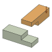
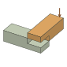

# Lige hjørneblad

Gå rundt om et hjørne i en tømmerramme. Her ender begge stykker ved hjørnet, og deres længderetninger drejer en kvart omgang.

## Samleretningen

Læg det underste blad på plads. Sænk det andet på tværs, så de resterende halve tykkelser udfylder hjørnet.

## Læs snittet

Det vandrette snit ligger i den øverste halvdel. Her fylder det tværgående overblad hjørnet. Den nederste halvdel tilhører det andet emne.

## Ved en besigtigelse

Spørg først, om begge stykker ender ved hjørnet. Fortsætter de på den anden side, er placeringen en anden, selv når fraskæringen ligner.

[Koch · Lige hjørneblad](https://danskbyggeskik.dk/publikationer/ordbog_fagudtryk_fra_det_traditionelle_byggeri.pdf#page=30) · [Kortfattet Lærebog i Husbygning · hjørneblade](https://danskbyggeskik.dk/publikationer/938%20-%20kortfattet%20l%C3%A6rebog%20i%20husbygning.%204.%20udg.pdf#page=56) · [G. v. Huth · tegning 137 · PDF-s. 34](https://danskbyggeskik.dk/publikationer/324%20-%20tr%C3%A6forbindelser%20for%20br%C3%A6der,%20planker%20og%20t%C3%B8mmer.%2024%20tavler%20med%20bem%C3%A6rkninger.pdf#page=34)

[SolidCraft-model](model.sc) · [Modelopskrift](model.json) · [Bogen](../README.md)
