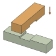
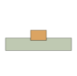

# Kæmning ved kryds

Forestil dig to vandrette stykker tømmer i forskellig højde. Ved krydset sænkes det øverste delvis ned over det nederste.

## Samleretningen

Læg det underste emne fast, vend det andet med indhakket nedad og sænk det over krydset. Indhakkenes sideflader styrer placeringen.

## Læs snittet

I længdesnittet gennem underemnet ses et lavt indgreb. Det øvre tømmer rager stadig op. Styrelsens figur D viser et indgreb nær enden; her er begge emner forlænget forbi krydset.

## Ved en besigtigelse

Registrér indhuggets sideflader og den tilbageværende højde. Sammenlign med hjørnebladet, hvor overfladerne ender i samme niveau.

[Slots- og Kulturstyrelsen · figur D](https://slks.dk/fileadmin/user_upload/SLKS/Omraader/Kulturarv/Bygningsfredning/Faglige_retningslinjer/3_Facader_og_ydervaegge/3.2_Bindingsvaerk.pdf#page=15)

[SolidCraft-model](model.sc) · [Modelopskrift](model.json) · [Bogen](../README.md)
