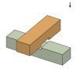
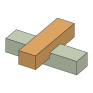

# Kæmning ved kryds

En bjælke skal ligge tværs over en anden og stadig rage op over den. Hvor meget træ behøver tømreren egentlig at tage væk for at få dem til at finde hinanden?

I denne kæmning får de to emner lave indhak. Det øverste sænkes, indtil snitfladerne mødes. Indhakkenes sider hjælper med at holde krydset på det tilsigtede sted. På Slots- og Kulturstyrelsens tegning ligger indgrebet nær en ende. Her fortsætter træet lidt længere, så krydsningen er let at følge.

Se langs oversiderne i den samlede figur. Der er stadig et niveauspring. Det er en forskel, du kan opdage i huset, før du får mulighed for at se ind i forbindelsen.

[Slots- og Kulturstyrelsen · figur D](https://slks.dk/fileadmin/user_upload/SLKS/Omraader/Kulturarv/Bygningsfredning/Faglige_retningslinjer/3_Facader_og_ydervaegge/3.2_Bindingsvaerk.pdf#page=15)

[SolidCraft-model](model.sc) · [Modelopskrift](model.json) · [Bogen](../README.md)
