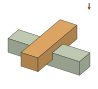

# Almindelig overskramning

Fire arme fra ét kryds. Begynd ved en vilkårlig ende og følg træet lige igennem til den modsatte. Gør det samme med det andet stykke. Begge fortsætter, og alligevel kan deres oversider ligge i samme højde.

Tømreren skærer et halvt indhug fra oversiden af det ene træstykke og et tilsvarende fra undersiden af det andet. Det øverste lægges ned i det nederste. Den forbindelse hedder en overskramning.

Set ovenfra ser krydset fyldt ud. Men tænk på hvert stykke for sig: Midt i krydset er kun halvdelen af dets egen højde tilbage. Regneøvelsen bag i bogen viser, hvad det betyder for det enkelte tværsnit.

[Kaare Kristensen · fig. 31 · PDF-s. 27](https://danskbyggeskik.dk/publikationer/487%20-%20t%C3%B8mrerarbejde.pdf#page=27) · [G. v. Huth · tegning 125 · PDF-s. 32](https://danskbyggeskik.dk/publikationer/324%20-%20tr%C3%A6forbindelser%20for%20br%C3%A6der,%20planker%20og%20t%C3%B8mmer.%2024%20tavler%20med%20bem%C3%A6rkninger.pdf#page=32)

[SolidCraft-model](model.sc) · [Modelopskrift](model.json) · [Bogen](../README.md)
