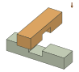
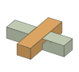

# Almindelig overskramning

To vandrette stykker skal fortsætte gennem et kryds med oversiderne i samme højde. I opmålingen er de fire arme den første ledetråd.

## Samleretningen

Læg det første emne med indhakket opad. Det andet har et modsvarende snit fra undersiden og sænkes på tværs ned over det første.

## Læs snittet

Det højtliggende plansnit går gennem det ene emne i hele krydset. På den anden side af samlingen ser man at det nederste emne fortsætter.

## Ved en besigtigelse

Mål dybden fra samme referenceflade på begge emner. Hvis et helt emne ligger højere, er en kæmning også værd at undersøge.

[Kaare Kristensen · fig. 31 · PDF-s. 27](https://danskbyggeskik.dk/publikationer/487%20-%20t%C3%B8mrerarbejde.pdf#page=27) · [G. v. Huth · tegning 125 · PDF-s. 32](https://danskbyggeskik.dk/publikationer/324%20-%20tr%C3%A6forbindelser%20for%20br%C3%A6der,%20planker%20og%20t%C3%B8mmer.%2024%20tavler%20med%20bem%C3%A6rkninger.pdf#page=32)

[SolidCraft-model](model.sc) · [Modelopskrift](model.json) · [Bogen](../README.md)
