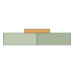

# Lask over et stød

Ved en samling med lask er der et tredje stykke at finde. Det kan krydse en fuge, som ellers ville dele de to længder helt.

## Samleretningen

Anbring træenderne i forlængelse af hinanden. Læg lasken hen over fugen, så den får anlæg på begge emner. Modellen viser en pålagt lask før fastgørelse.

## Læs snittet

I længdesnittet fortsætter laskens træ hen over den lodrette fuge. Kontakt alene fastholder den ikke. Fastgørelser, deres afstande og bæreevne kræver særskilt dokumentation.

## Ved en besigtigelse

Følg først laskens to ender og derefter stødet mellem de gamle emner. Registrér synlige fastgørelser og eventuel forskydning hver for sig.

[Koch · Laske](https://danskbyggeskik.dk/publikationer/ordbog_fagudtryk_fra_det_traditionelle_byggeri.pdf#page=30)

[SolidCraft-model](model.sc) · [Modelopskrift](model.json) · [Bogen](../README.md)
