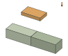
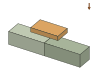
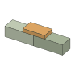

# Lask over et stød

Der er en enkel måde at kende en lask på: Find dens to ender. Lasken er et selvstændigt træstykke, der rækker hen over samlingen mellem to andre. På tegningen er den løftet fri, så alle tre dele kan tælles.

Læg den tilbage hen over stødet. Nu får lasken anlæg på begge sider af fugen. Den ligger foreløbig løst. Først en fastgørelse kan få den til at forbinde træenderne, når de prøver at flytte sig.

Ved en gammel reparation kan lasken være lettere at se end det træ, den dækker. Tegn først omridset af den og de fastgørelser, du kan finde. Led derefter efter stødet nedenunder. Du kan sagtens have fundet lasken, før du ved præcis, hvordan de oprindelige ender ser ud.

[Koch · Laske](https://danskbyggeskik.dk/publikationer/ordbog_fagudtryk_fra_det_traditionelle_byggeri.pdf#page=30)

[SolidCraft-model](model.sc) · [Modelopskrift](model.json) · [Bogen](../README.md)
