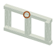

# Lige blad

Følg en vandret tømmerlængde til en forlængelse. Når skuldrene er synlige fra siden, står de forskudt med bladenes længde.

## Samleretningen

Det grønne stykke har træ tilbage i bunden. Sænk det okkerfarvede overblad, indtil den brede flade ligger an. De to skuldre afslutter overlappet.

## Læs snittet

I længdesnit skifter samlingen niveau to gange. Midt i overlappet deler de to blade tværsnittet. En ren bladform kan løftes fra hinanden igen.

## Ved en besigtigelse

Find begge skuldre før du anslår overlappets længde. Slots- og Kulturstyrelsens figur B viser også nagler. På modellen er de udeladt, så bladene kan ses.

[Koch · Lige blad](https://danskbyggeskik.dk/publikationer/ordbog_fagudtryk_fra_det_traditionelle_byggeri.pdf#page=30) · [Slots- og Kulturstyrelsen · figur B](https://slks.dk/fileadmin/user_upload/SLKS/Omraader/Kulturarv/Bygningsfredning/Faglige_retningslinjer/3_Facader_og_ydervaegge/3.2_Bindingsvaerk.pdf#page=15)

[SolidCraft-model](model.sc) · [Modelopskrift](model.json) · [Bogen](../README.md)
