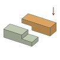
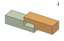
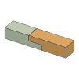
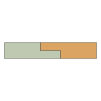

# Lige blad

En bjælke kan slutte to steder på én gang. Dens fulde højde ender ved den første skulder. Et tyndere stykke træ rækker videre og møder først sin ende ved den næste. Det fremspring kalder tømreren et blad.

På den ene bjælke lader tømreren den nederste halvdel stå. På den anden bliver den øverste stående. Læg de to blade over hinanden, og bjælken får sin fulde højde igen. Skuldrene er de små trin, hvor den fulde bjælke bliver til halvt træ.

Se nu på siden af den samlede bjælke. Afstanden mellem de to skuldre fortæller, hvor langt bladene overlapper. Mens de ligger løst, kan overbladet stadig løftes. På Slots- og Kulturstyrelsens tegning går der nagler gennem begge blade.

[Koch · Lige blad](https://danskbyggeskik.dk/publikationer/ordbog_fagudtryk_fra_det_traditionelle_byggeri.pdf#page=30) · [Slots- og Kulturstyrelsen · figur B](https://slks.dk/fileadmin/user_upload/SLKS/Omraader/Kulturarv/Bygningsfredning/Faglige_retningslinjer/3_Facader_og_ydervaegge/3.2_Bindingsvaerk.pdf#page=15)

[SolidCraft-model](model.sc) · [Modelopskrift](model.json) · [Bogen](../README.md)
