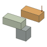
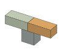
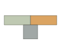

# Lige stød

Se op langs en vandret rem til det sted, hvor to længder tømmer mødes over en stolpe. En smal lodret fuge kan være det eneste synlige spor.

## Samleretningen

Læg den første ende på stolpen, og sænk den anden ved siden af. Begge ender skal nå ind over understøtningen. Den grå del på tegningen er stolpens top.

## Læs snittet

Længdesnittet viser to plane endeflader og en ubrudt stolpetop nedenunder. Hver ende har sit eget anlæg.

## Ved en besigtigelse

Kan du se understøtningen under begge ender? Hvis loft eller beklædning skjuler den, så tegn dens placering som uafklaret.

[Koch · Lige stød](https://danskbyggeskik.dk/publikationer/ordbog_fagudtryk_fra_det_traditionelle_byggeri.pdf#page=30)

[SolidCraft-model](model.sc) · [Modelopskrift](model.json) · [Bogen](../README.md)
